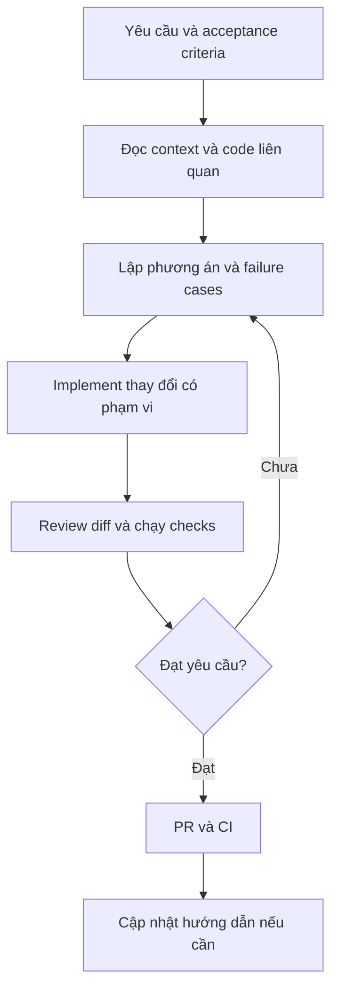

# AI Coding với Claude: AGENTS.md, Rules & Skills

Tài liệu ôn phỏng vấn Backend / Senior Engineer • 06/11/2026

## 1. Mục tiêu và cách trình bày

Thể hiện khả năng tổ chức context cho AI, giao việc có phạm vi, kiểm tra kết quả và cải thiện workflow. AI giúp phân tích, implement, test và review; kỹ sư vẫn chịu trách nhiệm về thiết kế và tính đúng đắn.

Các cấu hình dưới đây là ví dụ đề xuất cho NestJS + MongoDB + BullMQ, không phải xác nhận rằng đã được triển khai trong dự án. Khi phỏng vấn, chỉ dùng “I implemented” cho việc thực sự đã làm; dùng “I would” cho cách tiếp cận đề xuất.

## 2. Bản đồ các thành phần

| Thành phần | Vai trò | Ví dụ |
|---|---|---|
| AGENTS.md / CLAUDE.md | Context chung và hướng dẫn làm việc trong repository | Kiến trúc, commands, conventions |
| Rules | Ràng buộc theo chủ đề hoặc phạm vi | Payment phải xét duplicate và timeout |
| Skills | Quy trình tái sử dụng cho một loại nhiệm vụ | Review webhook, điều tra bug |
| Subagents | Agent có context riêng được giao một phần việc | Review security trong phạm vi cụ thể |
| MCP / tools | Cách agent truy cập công cụ hoặc dữ liệu | Đọc issue, tìm tài liệu, chạy command |
| Hooks / CI | Kiểm tra hoặc hành động bằng logic thực thi | Lint, test, secret scanning |

**AGENTS.md không tạo agent. Skill không mặc định là subagent. Rules trong Markdown không bảo đảm cưỡng chế hành vi.**

Trong Claude Code, CLAUDE.md là file hướng dẫn quen thuộc. Việc đọc trực tiếp AGENTS.md phụ thuộc phiên bản và cấu hình. Khi cần chia sẻ hướng dẫn giữa các công cụ, có thể đặt `@AGENTS.md` trong CLAUDE.md. Không nên giả định mọi công cụ có cùng cách load và giải quyết xung đột.

## 3. Workflow tổng thể



| Bước | Developer cung cấp / quyết định | Agent hỗ trợ | Bằng chứng cần có |
|---|---|---|---|
| Context | Business rules, phạm vi, code liên quan | Tìm và đọc implementation | Hiểu đúng flow hiện tại |
| Phân tích | Chọn trade-off phù hợp | Đề xuất cách làm và edge cases | Failure scenarios cụ thể |
| Implement | Giới hạn thay đổi | Sửa code theo patterns hiện tại | Diff tập trung |
| Verify | Chọn tiêu chí kiểm tra | Chạy checks, phân tích lỗi | Kết quả chạy thực tế |
| Review | Quyết định chấp nhận | Tổng hợp thay đổi và hạn chế | Không bỏ qua lỗi chưa giải quyết |

## 4. Tổ chức repository

| File | Mục đích |
|---|---|
| AGENTS.md | Hướng dẫn chung dùng lại giữa các công cụ |
| CLAUDE.md | Import AGENTS.md và bổ sung hướng dẫn riêng nếu cần |
| .claude/rules/payments.md | Rules khi sửa payment / refund |
| .claude/rules/database.md | Rules khi sửa MongoDB |
| .claude/skills/review-webhook/SKILL.md | Quy trình review webhook |
| .claude/skills/review-webhook/references/failure-cases.md | Checklist chi tiết nếu cần |

Đây là ví dụ cấu trúc cho Claude Code. Đường dẫn của rules và skills phải theo công cụ thực tế sử dụng.

## 5. Ví dụ AGENTS.md

```markdown
# Project context
- Backend: NestJS and TypeScript.
- Database: MongoDB replica set.
- Background jobs: BullMQ and Redis.
- Follow existing module boundaries and dependency injection patterns.

# Working process
- Read the relevant implementation before proposing changes.
- For complex changes, explain the approach and failure cases first.
- Keep changes focused on the requested task.
- Explain why a new dependency is needed before adding it.

# Validation
- Read package.json for the available validation commands.
- Run relevant checks after changing code.
- Report what was checked and what could not run.
- Never claim a test passed without running it.
```

Nên thêm các commands chính xác của repo sau khi xác minh. Không ghi lệnh test giả định hoặc copy nguyên cấu hình của dự án khác.

### CLAUDE.md dùng chung context

```markdown
@AGENTS.md
```

Giữ một nguồn hướng dẫn chung để tránh hai file có cùng nội dung nhưng cập nhật lệch nhau. Kiểm tra context thực sự được nạp trong phiên làm việc.

## 6. Ví dụ rules

### .claude/rules/payments.md

```markdown
---
paths:
  - "src/payments/**/*.ts"
  - "src/refunds/**/*.ts"
---

# Payment changes
- Check how duplicate requests and events are handled.
- Do not assume a timeout means the provider rejected a request.
- Keep provider calls outside retryable database transaction callbacks.
- Use the project's money representation; avoid floating-point arithmetic.
- Add relevant tests for retries and partial failures.
```

`paths` giới hạn phạm vi áp dụng trong Claude Code. Phải sửa glob cho đúng cấu trúc repo; ví dụ code nằm dưới `src/modules/payments/` thì pattern trên cần đổi.

### .claude/rules/database.md

```markdown
---
paths:
  - "src/**/*.repository.ts"
  - "src/**/*.schema.ts"
---

# MongoDB changes
- Check indexes against the actual query patterns.
- Use conditional writes when concurrent requests compete for state.
- Use transactions when related writes must commit together.
- Confirm all participating operations use the intended session.
- Check transaction retry behavior and avoid external side effects inside it.
```

Nếu business writes nằm trong service files, scope cũng phải bao phủ các files đó. Rule không hữu ích nếu không match code thực tế.

## 7. Ví dụ skill review webhook

File: `.claude/skills/review-webhook/SKILL.md`

```markdown
---
name: review-webhook
description: Review payment webhook handlers and queue workers for duplicate processing, retries, ordering, and partial failures.
---

1. Trace the flow from HTTP receipt to the final business update.
2. Check signature validation and acknowledgement timing.
3. Identify durable storage and the enqueue failure window.
4. Check idempotency for database writes and external calls.
5. Check worker crashes, retries, and out-of-order events.
6. Check failed-job recovery and monitoring.
7. Report findings with:
   - file and location
   - failure scenario
   - business impact
   - suggested fix
8. State which checks were executed and which remain unverified.
```

Trong Claude Code có thể gọi `/review-webhook`. Mô tả rõ giúp chọn skill phù hợp; phần hướng dẫn được nạp khi sử dụng. Có thể thêm references và scripts khi cần, nhưng không nhét toàn bộ tài liệu vào SKILL.md.

| Cần lưu | Đặt ở đâu? |
|---|---|
| Các bước review cốt lõi | SKILL.md |
| Danh sách failure cases dài | references/ |
| Script kiểm tra có thể chạy lại | scripts/ |
| Template đầu ra | assets/ hoặc tài nguyên tham chiếu phù hợp |

## 8. Case thực tế để trình bày: duplicate refund

**Bài toán:** Hai request hủy cùng một đơn gần như đồng thời có thể gây hoàn tiền hai lần.

### Prompt đề xuất

```text
Review the order cancellation and refund flow.

Business rules:
- An order must not be refunded twice.
- Refunds must not exceed net paid:
  total payments minus previous refunds.
- Concurrent requests must be handled safely.
- Related database changes must remain consistent.

First, explain the current flow and failure scenarios.
Then propose a focused change and relevant tests.
Do not assume that a provider timeout means the refund failed.
```

### Những điều developer phải kiểm chứng

| Tình huống | Rủi ro | Cần kiểm tra |
|---|---|---|
| Request lặp sau khi hủy thành công | Refund thêm lần nữa | Trạng thái, refund record và idempotency |
| Hai request đọc cùng trạng thái | Cả hai cùng vượt qua if-check | Conditional write / transaction và xử lý conflict |
| Provider hoàn tiền nhưng API timeout | Retry tạo refund mới | Stable idempotency key và đối soát trạng thái provider |
| Transaction callback được chạy lại | External call bị lặp | Không gọi provider bên trong callback có thể retry |
| DB cập nhật nhưng enqueue thất bại | Công việc không được thực thi | Durable job intent, outbox hoặc cơ chế recovery phù hợp |
| Worker chết sau side effect | Job chạy lại tạo tác động trùng | Idempotent processing và recovery |
| Tiền đã hoàn nhưng DB chưa cập nhật | Trạng thái nội bộ sai | Reconciliation và retry cập nhật có kiểm soát |

Một transaction MongoDB không tự làm cho external payment call trở thành atomic với DB. Thiết kế cần xét riêng idempotency, trạng thái trung gian và reconciliation.

### Sample answer

> I would ask Claude to trace the cancellation flow and identify where duplicate refunds could happen. Then I would review the concurrency control and the external payment call separately. A status check alone is not enough because two requests can read the same state. I would verify the database protection, the provider idempotency key, and recovery after a timeout. Finally, I would test repeated requests, concurrent requests, and partial failures.

## 9. Câu trả lời giới thiệu workflow — khoảng 60 giây

> I organise the AI setup into three parts. First, I keep stable project context in AGENTS.md or CLAUDE.md, including the architecture, conventions, and validation commands. Second, I use scoped rules for areas such as payments and database changes. Third, I create skills for repeated workflows, such as reviewing a webhook or investigating a bug. I keep these files in version control and update them when the project changes. I also verify that the instructions are loaded and evaluate them on real tasks. These files guide the agent, but correctness still depends on implementation, tests, and code review.

## 10. Câu hỏi phỏng vấn: setup và context

| Question | Sample answer |
|---|---|
| How would you set up Claude Code for a new repository? | I start by understanding the existing architecture and commands. Then I create a short project instruction file, add scoped rules where needed, and introduce skills for repeated workflows. |
| What belongs in AGENTS.md? | Stable project context, important conventions, and validation commands. I focus on information that is easy to miss or expensive to rediscover. |
| Why not put everything in one file? | A large file adds context and becomes harder to maintain. I keep general guidance short and move specialised procedures into skills. |
| How do you know the instructions were loaded? | I inspect the tool's loaded context and try a small representative task. I verify the behaviour rather than relying only on the agent saying it read the files. |
| What if instructions conflict? | I check which files apply and how the tool resolves them. Then I remove the conflicting guidance so future sessions receive consistent instructions. |
| How do you handle a monorepo? | I keep shared guidance at the root and scope detailed instructions to the relevant package or files. I also verify the working directory and commands for each task. |
| How do you manage context size? | I provide relevant code and concise instructions. I move long references out of always-loaded context and avoid loading unrelated files. |
| Can you share instructions across tools? | I keep common project guidance in one place and use tool-specific configuration where needed. I verify each tool's loading behaviour. |

## 11. Câu hỏi phỏng vấn: rules và skills

| Question | Sample answer |
|---|---|
| What is the difference between a rule and a skill? | A rule states a constraint. A skill describes a repeatable procedure with steps and expected outputs. |
| When would you create a skill? | When I repeatedly use the same multi-step workflow and can define clear inputs, steps, and outputs. |
| How do you evaluate a skill? | I test representative tasks and check missed cases, incorrect findings, unnecessary changes, and review effort. |
| What if a skill triggers too often? | I narrow its description and scope. If selection is still unreliable, I invoke it explicitly. |
| What if the agent ignores a rule? | I check whether it loaded, whether it was clear, and whether it conflicted with other guidance. For critical requirements, I add executable checks. |
| How do you maintain these files? | I keep them in version control, review changes like code, and update them when the architecture or workflow changes. |
| Do skills guarantee better results? | No. I compare their behaviour on real tasks. A skill is useful only if it improves the result or reduces the effort needed to verify it. |
| Does AGENTS.md create multiple agents? | No. It provides instructions. Subagents are configured separately and need clear tasks and boundaries. |

## 12. Câu hỏi phỏng vấn: kiểm soát và failure handling

| Question | Sample answer |
|---|---|
| Do rules guarantee correctness? | No. They guide the model. I use tests, static checks, permissions, and CI for requirements that need enforcement. |
| Would you accept a status check to prevent duplicate refunds? | Not by itself. Two requests could read the same state. I would verify concurrency control and test simultaneous requests. |
| What if Claude writes tests that pass but miss the bug? | I compare the tests with the business rules and add a concrete failure scenario. Passing tests are useful only if they cover the relevant behaviour. |
| How do you prevent unrelated changes? | I define the scope, request small changes, and review the diff. If it expands unexpectedly, I ask for the reason before accepting it. |
| What if the agent cannot run tests? | I ask it to report that clearly and explain what remains unverified. I run the required checks in an appropriate environment before merging. |
| How do you protect secrets? | I use approved tools, avoid sharing secrets and customer data, and apply access controls and secret scanning. A Markdown instruction alone is not enough. |
| How do you measure AI's value? | I look at delivery time, review effort, defects, and rework. More generated code does not necessarily mean more value. |
| When would you use subagents? | For independent tasks with clear boundaries. I avoid parallel edits to tightly coupled code and review the combined result. |

## 13. Cách đánh giá setup trước khi dùng rộng rãi

| Nhiệm vụ thử | Kết quả mong muốn |
|---|---|
| Sửa validation đơn giản | Đúng patterns, diff nhỏ, chạy check phù hợp |
| Review refund có race condition | Nhận diện concurrent requests và provider timeout |
| Review webhook enqueue failure | Nhìn thấy khoảng trống giữa DB write và queue write |
| Sửa file ngoài payment scope | Không kéo checklist payment vào mọi thay đổi |
| Môi trường không chạy được test | Báo chưa xác minh, không tuyên bố test pass |

Dùng cùng loại nhiệm vụ để so sánh trước và sau khi sửa hướng dẫn. Kiểm tra cả việc skill nên được dùng và trường hợp không nên được dùng. Cập nhật một lỗi thành rule khi đó là bài học có thể tái sử dụng, tránh thêm rule riêng cho mọi sự cố nhỏ.

## 14. Những lỗi setup nên tránh

| Lỗi | Cải thiện |
|---|---|
| File hướng dẫn quá dài và lặp lại | Giữ context chung ngắn, tách procedure |
| Rules chung chung như “write clean code” | Viết yêu cầu có thể kiểm chứng |
| Glob không match code | Kiểm tra đường dẫn thực tế |
| Commands lỗi thời | Xác minh từ repo và CI hiện tại |
| Copy rules từ dự án khác | Chọn theo stack và business rules thực tế |
| Xem AI review là approval cuối cùng | Giữ review và checks phù hợp với mức rủi ro |
| Tuyên bố đã làm khi mới biết lý thuyết | Phân biệt rõ kinh nghiệm thực tế và cách làm đề xuất |

## 15. Câu ngắn để nhớ

> I use project instructions for context, rules for constraints, and skills for repeatable workflows. I verify the result through code review and executable checks.

## 16. Tài liệu chính thức

Các cơ chế load có thể thay đổi theo phiên bản. Kiểm tra tài liệu và cấu hình công cụ đang dùng.

- [Claude Code: memory, CLAUDE.md, AGENTS.md và rules](https://code.claude.com/docs/en/memory)
- [Claude Code: skills](https://code.claude.com/docs/en/skills)
- [OpenAI: AGENTS.md](https://developers.openai.com/codex/guides/agents-md)
