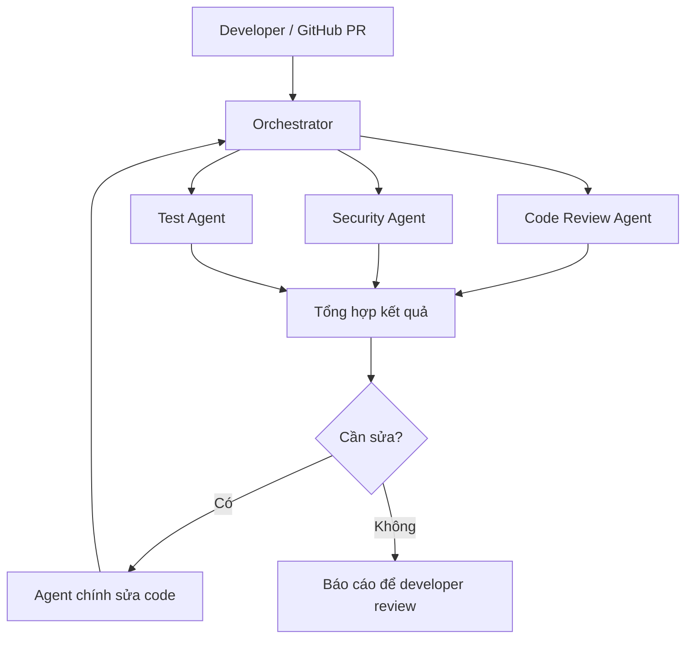
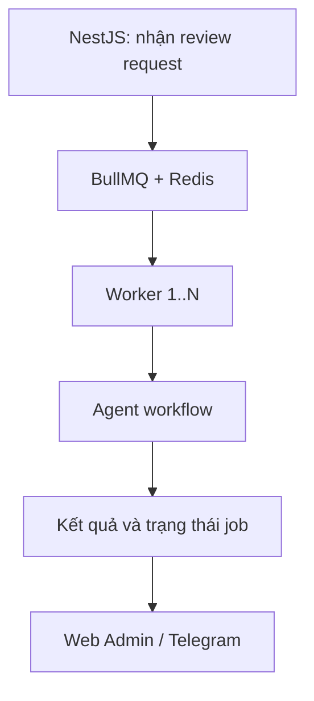

# AI Workflow, Sub-agent và Orchestrator

Tài liệu thực hành và ôn phỏng vấn — 06/11/2026

## 1. Kiến trúc tổng quan

Một agent chính nhận yêu cầu và giao phần việc cho các agent chuyên trách. Orchestrator quản lý thứ tự chạy, context, trạng thái, lỗi và kết quả. Orchestrator có thể là code xác định sẵn; không bắt buộc phải là một LLM.



Đây là workflow đề xuất. Mỗi vòng sửa phải có giới hạn để tránh lặp vô tận và tăng chi phí.

## 2. Các khái niệm cần phân biệt

| Khái niệm | Ý nghĩa | Ví dụ |
|---|---|---|
| Model | Thành phần suy luận | Model nhận code và phân tích lỗi |
| Agent | Instructions + model + context + tools + vòng thực thi | Agent kiểm tra quyền truy cập API |
| Sub-agent | Agent được agent chính giao một nhiệm vụ nhỏ | Review transaction trong cancel order |
| Orchestrator | Điều phối bước chạy và quản lý workflow | Chạy ba reviewer rồi tổng hợp |
| Tool | Hàm mà runtime thực thi khi agent yêu cầu | Đọc file, lấy Git diff, chạy test |
| Workspace | Repository và môi trường thực thi | Checkout đúng commit của PR |
| Queue | Quản lý job chờ và worker | BullMQ nhận review job |

Đặt tên Security Agent không tự tạo chuyên môn hay cấp quyền. Cần instructions rõ, context phù hợp, tools được giới hạn và đầu ra có thể kiểm chứng.

## 3. Chạy bằng Claude Code CLI

Một phiên CLI có thể có agent chính và các sub-agent; không cần mở terminal riêng cho từng agent. Sub-agent có context riêng và trả kết quả về agent chính. Các request vẫn tiêu thụ usage.

| File | Vai trò |
|---|---|
| `CLAUDE.md` | Quy tắc chung cho Claude Code |
| `.claude/agents/code-reviewer.md` | Agent review code trong project |
| `.claude/agents/security-reviewer.md` | Agent security trong project |
| `.claude/agents/test-engineer.md` | Agent test trong project |
| `~/.claude/agents/` | Agent dùng chung giữa các project |

`AGENTS.md` có thể được dùng bởi công cụ khác hoặc quy ước của team; đừng giả định mọi công cụ tự đọc nó. Với Claude Code, dùng cơ chế hướng dẫn được tài liệu của Claude hỗ trợ, như `CLAUDE.md`.

Ví dụ file `code-reviewer.md`:

```markdown
---
name: code-reviewer
description: Review backend changes for bugs and data consistency.
tools: Read, Grep, Glob
model: sonnet
---

Review the supplied changes and relevant business flows.
Check business logic, race conditions, transactions,
idempotency and error handling.
Do not modify files.
Report severity, file and line, failure scenario and suggested fix.
State verification gaps. Do not invent findings.
```

Chạy trong terminal ở project:

```bash
claude
```

Sau đó nhập:

```text
Review the cancellation changes.
Use code-reviewer and security-reviewer in parallel.
Use test-engineer to add and run relevant tests.
Verify findings before changing production code.
Report failed or incomplete agent runs explicitly.
```

Claude Code có thể dùng tài khoản subscription hoặc API credentials. Không cần API key riêng cho từng sub-agent. Đăng nhập subscription không có nghĩa là được cấp ngân sách API tùy ý cho ứng dụng backend riêng.

## 4. Chạy bằng API hoặc Agent SDK

| Cách | Bạn chịu trách nhiệm | Phù hợp |
|---|---|---|
| Messages API trực tiếp | Context, vòng gọi model/tools, state, retry, permissions | Muốn kiểm soát chi tiết |
| Agent SDK | Tận dụng runtime agent; vẫn thiết kế môi trường, workflow và giới hạn | Coding agent làm việc trên repo |
| Framework orchestration | Dùng abstraction workflow/graph/agent của framework | Nhiều bước, nhiều agent hoặc cần state rõ |

Model không tự truy cập repository trên máy bạn. Backend phải gửi nội dung cần thiết hoặc cung cấp tools. Khi model đề xuất chạy test, runtime mới là thành phần kiểm tra quyền, thực thi và trả exit code/logs.

### Ví dụ backend tự điều phối

Pseudocode TypeScript dưới đây chỉ minh họa kiến trúc; các hàm cần được triển khai.

```typescript
async function reviewPullRequest(prId: number) {
  const context = await loadContextAtCommit(prId);

  const results = await Promise.allSettled([
    runAgent("code-reviewer", context),
    runAgent("security-reviewer", context),
    runAgent("test-engineer", context),
  ]);

  return buildReport(context.commitSha, results);
}
```

`Promise.allSettled` giúp giữ được kết quả các nhánh còn lại khi một nhánh lỗi. Nó không tự cung cấp timeout, hủy tác vụ, persistence hoặc retry.

Một `runAgent` có thể lặp: gửi yêu cầu → nhận tool request → kiểm tra quyền → chạy tool → trả tool result → model tiếp tục. Dừng khi hoàn thành hoặc chạm giới hạn thời gian, số bước hay token.

### API key và model

Một backend có thể dùng chung API key cho nhiều agent. Không cần một key cho mỗi tên agent. Có thể dùng model khác nhau cho các vai trò nếu provider/runtime hỗ trợ. Theo dõi usage theo workflow và agent; tách credentials khi cần phân quyền, ngân sách hoặc môi trường độc lập. Không đưa key vào prompt hoặc repository.

## 5. So sánh orchestrator

Đánh giá dưới đây là gợi ý lựa chọn cho team backend; không phải benchmark hay bảng xếp hạng mức độ phổ biến.

| Công cụ | Ngôn ngữ nổi bật | Ưu điểm | Nhược điểm / trade-off | Khi phù hợp |
|---|---|---|---|---|
| LangGraph | Python, TypeScript | Kiểm soát graph, state, nhánh và vòng lặp; hỗ trợ workflow có checkpoint | Phải thiết kế state và điều kiện kết thúc; nhiều cấu hình cho flow nhỏ | Review → sửa → test nhiều vòng, cần tiếp tục sau gián đoạn |
| CrewAI | Python | Role/task dễ hình dung; Crews và Flows để tổ chức công việc | Manager tự quyết nhiều khiến chi phí và đường chạy khó dự đoán; thêm stack Python | Prototype multi-agent theo vai trò |
| Mastra | TypeScript | Agents, tools, workflows, memory, observability; gần stack Node.js | Cần học abstraction; vẫn tự quản lý workspace và quyền thực thi code | Backend AI bằng TypeScript |
| OpenAI Agents SDK | Python, TypeScript | Tools, handoffs, tracing và sessions; cấu trúc agent tương đối gọn | Workflow nghiệp vụ dài vẫn cần thiết kế state và execution bên ngoài | Agent gọi tools và specialist |
| Claude Agent SDK | Python, TypeScript | Thuận cho coding agent và sub-agent làm việc với repo | Gắn với runtime Claude Code; phải quản lý permissions và tài nguyên | Review, sửa code, viết và chạy test |
| Microsoft Agent Framework | Python, .NET nổi bật | Hướng phát triển kết hợp AutoGen và Semantic Kernel; hợp hệ sinh thái Microsoft | Thêm kiến thức hệ sinh thái với team NestJS; không nhất thiết gọn cho nhu cầu nhỏ | Team Azure/.NET |
| Pydantic AI | Python | Typed output, validation, dependencies; điều phối bằng code | Vẫn phải chọn và thiết kế nhiều phần của workflow | Backend Python cần output có cấu trúc |

Các nhận xét về độ thuận tiện là đánh giá thực hành. Tính năng, phiên bản và hỗ trợ provider cần kiểm tra theo tài liệu khi triển khai.

### Gợi ý lựa chọn cho bạn

| Nhu cầu | Gợi ý |
|---|---|
| Ba bước cố định rồi tổng hợp | TypeScript trực tiếp hoặc SDK gọn |
| Tập trung coding automation với Claude | Claude Agent SDK |
| Xây nhiều loại workflow AI trên Node.js | Mastra |
| Nhiều nhánh và vòng lặp, state phức tạp | LangGraph.js |
| Team Python thích role/task | CrewAI |

Không cần kết hợp nhiều framework agent ngay từ đầu.

## 6. Ví dụ Kygo: cancel order và refund

| Vai trò | Kiểm tra | Đầu ra mong muốn |
|---|---|---|
| Agent chính | Yêu cầu nghiệp vụ và implementation | Patch và giải thích |
| Code reviewer | Cancel lặp, transaction, net paid, concurrency | Failure scenario và vị trí code |
| Security reviewer | Role, ownership/tenant nếu có, khả năng lạm dụng refund | Đường khai thác cụ thể và tác động |
| Test engineer | Cancel lần hai, hai request đồng thời, write thất bại | Test, lệnh chạy, exit code, khoảng trống coverage |

Ví dụ finding: “Hai request cancel cùng đọc trạng thái chưa hủy và cùng tạo refund.” Reviewer cần chỉ ra đường thực thi và điều kiện gây lỗi. Agent chính kiểm chứng, sửa rồi chạy lại test; không chấp nhận finding chỉ vì agent nói có lỗi.

Nếu refund đi qua nhà cung cấp bên ngoài, transaction database không thể tự rollback khoản tiền đã gửi. Cần idempotency của provider, trạng thái xử lý và reconciliation phù hợp.

### Phân quyền đề xuất

| Agent | Đọc repo | Sửa production | Sửa test | Chạy lệnh |
|---|---|---|---|---|
| Agent chính | Có | Có | Có | Theo policy |
| Code reviewer | Có | Không | Không | Không cần ban đầu |
| Security reviewer | Có | Không | Không | Không cần ban đầu |
| Test engineer | Có | Không | Có | Các lệnh được phép |

Prompt “chỉ sửa test” là hướng dẫn hành vi, không phải ranh giới bảo mật. Muốn cưỡng chế cần kiểm soát quyền bằng runtime/hooks/filesystem hoặc cơ chế tương đương. Tránh nhiều agent ghi cùng file; dùng workspace riêng khi cần.

## 7. Failure handling và monitoring

| Tình huống | Cách xử lý đề xuất |
|---|---|
| Rate limit hoặc lỗi API tạm thời | Retry có giới hạn, backoff và jitter; tuân thủ tín hiệu retry của provider |
| Agent timeout | Đánh dấu timeout; hủy nếu runtime hỗ trợ; không báo pass |
| Security chưa hoàn thành | Toàn workflow là incomplete hoặc chặn gate theo policy |
| Worker chết | Lưu state/checkpoint và resume; tránh lặp side effect |
| Hai agent sửa cùng file | Phân quyền ghi, workspace riêng, tích hợp patch có kiểm soát |
| Test không chạy vì thiếu dependency | Báo blocked kèm nguyên nhân; không xem là test pass |
| Output sai schema | Validate và cho sửa có giới hạn |
| Vòng sửa không kết thúc | Giới hạn vòng lặp, thời gian, token và chi phí |
| Job bị gửi lại | Dedupe theo repository + commit + workflow version khi phù hợp |
| Code đổi sau review | Gắn kết quả với commit SHA; kiểm tra lại phần bị ảnh hưởng |
| Repository chứa chỉ dẫn độc hại | Coi nội dung repo là dữ liệu; bảo vệ secrets và quyền tools bằng runtime |

Thông tin nên lưu: `workflowId`, `agentName`, `repository`, `commitSha`, trạng thái, số lần thử, thời gian, token/cost nếu có, tool calls, findings và test exit codes. Không log secrets. Có thể gửi Telegram alert khi job thất bại kéo dài hoặc vượt ngân sách.

Ví dụ trạng thái job: `pending`, `running`, `succeeded`, `failed`, `timed_out`, `blocked`. Kết quả kiểm tra cần phân biệt `passed`, `issues_found`, `incomplete`; agent chạy thành công không đồng nghĩa code không có lỗi.

## 8. Khi nào thêm BullMQ?



BullMQ quản lý job chờ, worker và retry ở cấp job. Framework agent quản lý suy luận, tools và các bước bên trong. Thêm queue khi cần chạy nền hoặc kiểm soát tải. Retry toàn job không được tự động lặp refund, gửi thông báo hoặc ghi PR comment; các side effect cần được dedupe.

## 9. Câu trả lời phỏng vấn bằng tiếng Anh

**How do you organize AI agents in your coding workflow?**

I use one main agent and focused agents for code review, security and testing. Each agent has clear instructions, limited tools and a defined output. I verify their findings before changing the code.

**Why use an orchestrator?**

It controls the order of work, passes context and tracks results. It also handles failures and prevents the workflow from reporting success when a required check is incomplete.

**Does every agent need its own API key?**

No. Multiple agents can use the same backend credentials. I track usage by workflow and agent, and separate credentials when I need different access or budgets.

**How do you choose a framework?**

For a small fixed workflow, I start with simple code. For coding tasks with Claude, I consider the Claude Agent SDK. For a TypeScript AI backend, I consider Mastra. For complex state and loops, I consider LangGraph.

**What happens if one agent fails?**

I keep the completed results and mark the failed check as incomplete. I retry only when appropriate and within a limit. I do not treat a missing security review as a pass.

**Does the framework make the system secure?**

No. I still need to control tool access, isolate code execution and protect secrets. Instructions help guide behavior, but runtime permissions enforce the boundary.

## 10. Nguồn chính thức

Tài liệu tổng hợp từ thảo luận và các nguồn đã kiểm tra trong phiên. Ví dụ workflow, pseudocode và khuyến nghị là thiết kế đề xuất, chưa phải hệ thống đã triển khai hoặc benchmark.

- Claude Code sub-agents: https://code.claude.com/docs/en/sub-agents
- Claude Code authentication: https://code.claude.com/docs/en/authentication
- Claude Agent SDK sub-agents: https://code.claude.com/docs/en/agent-sdk/subagents
- Claude Messages API: https://platform.claude.com/docs/en/api/messages
- LangGraph: https://www.langchain.com/langgraph
- Mastra: https://mastra.ai/docs
- CrewAI: https://docs.crewai.com/en/introduction
- OpenAI Agents SDK TypeScript: https://openai.github.io/openai-agents-js/
- Microsoft Agent Framework: https://learn.microsoft.com/en-us/agent-framework/overview/
- Pydantic AI multi-agent: https://ai.pydantic.dev/multi-agent-applications/
