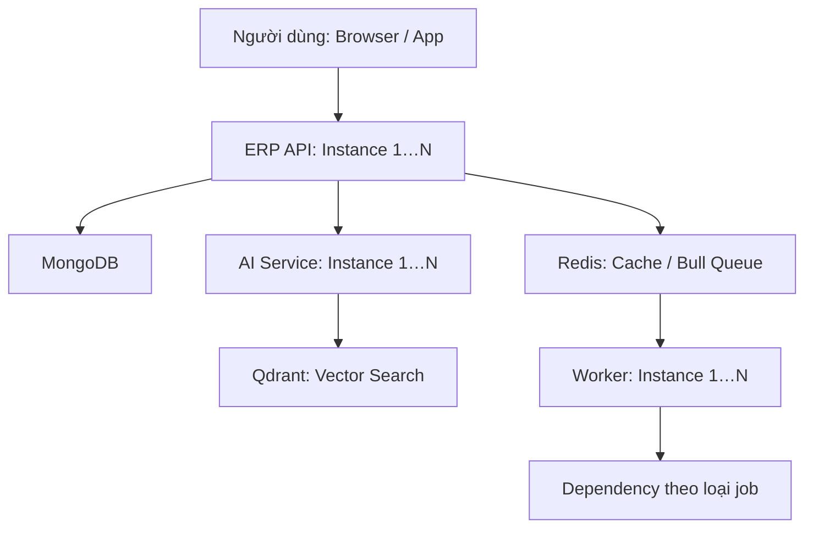
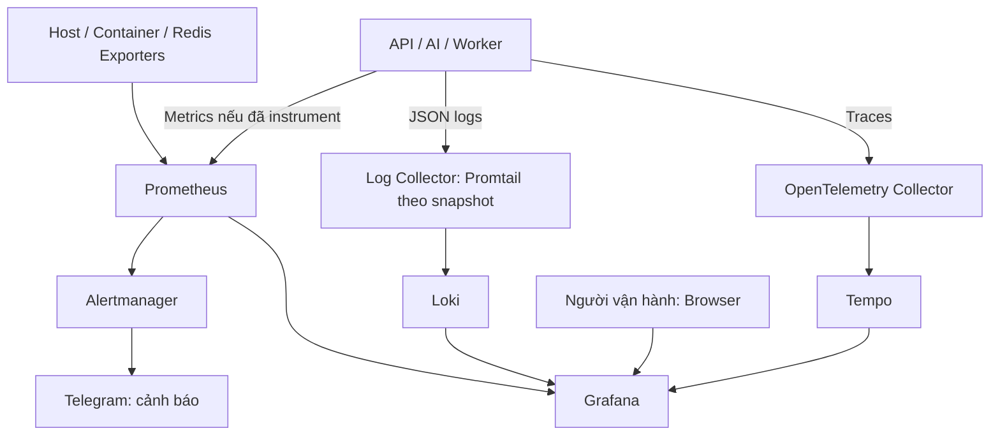
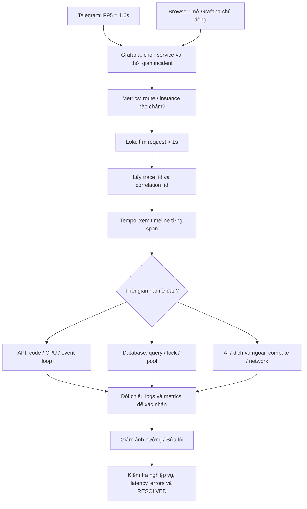
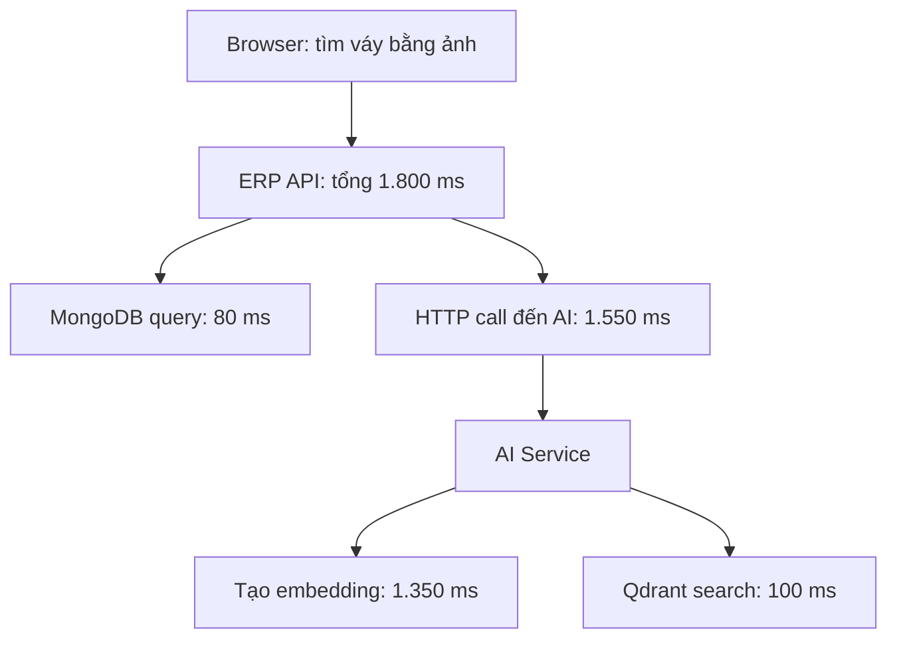
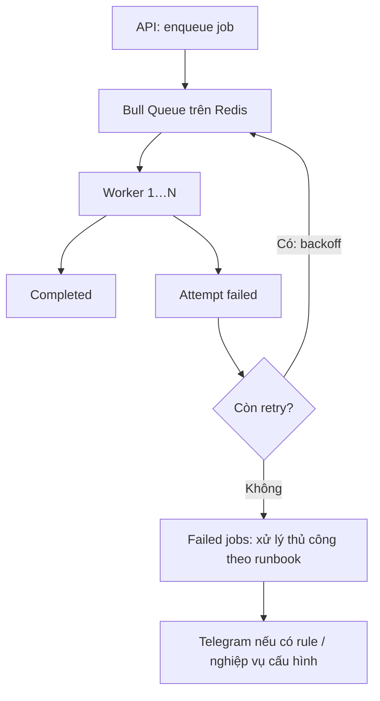

# Distributed System Monitoring — System Architecture & Incident Runbook

Ngày: 05/11/2026 · Ví dụ áp dụng: Kygo ERP API (NestJS), AI Service (FastAPI), MongoDB, Redis/Bull và Qdrant.

Mục tiêu: nhìn sơ đồ để hiểu hệ thống; từ alert Telegram hoặc Grafana trên browser tìm được endpoint chậm, request cụ thể và bước gây chậm; xử lý rồi xác nhận phục hồi.

> Phạm vi: tài liệu hướng dẫn dựa trên hai tài liệu Kygo đã cung cấp và nội dung trao đổi. Không phải kết quả kiểm tra production. Các liên kết, pipeline và thay đổi đã deploy cần được xác minh. Instance 1…N thể hiện khả năng mở rộng; worker là vai trò logic, có thể chạy cùng tiến trình API.

## 1. System Architecture

### 1.1 Luồng nghiệp vụ



Redis cache và queue là hai cách dùng khác nhau. Worker nhận job từ queue; không phải mọi request API đều đi qua worker. Một số job AI có thể gọi AI Service; job gửi thông báo gọi Telegram.

### 1.2 Luồng monitoring



Mũi tên metrics biểu diễn luồng dữ liệu: Prometheus chủ động scrape API/exporters. Snapshot xác nhận có các container này, chưa chứng minh mọi pipeline đang ingest đúng. Metrics AI/worker và metrics queue cần cấu hình riêng nếu chưa có.

| Thành phần | Vai trò | Câu hỏi trả lời |
|---|---|---|
| Prometheus | Lưu metrics và đánh giá alert rules | Route nào chậm, bao nhiêu request, lỗi tăng không? |
| Alertmanager | Group, deduplicate, route thông báo | Gửi cảnh báo đến Telegram như thế nào? |
| Grafana | Giao diện browser cho metrics/logs/traces | Mở ở đâu để điều tra? |
| Loki | Lưu và tìm JSON logs | Request/job đã xảy ra chuyện gì? |
| Tempo | Lưu và tìm distributed traces | Thời gian mất ở service/bước nào? |
| OpenTelemetry Collector | Nhận và chuyển telemetry theo pipeline | Traces từ ứng dụng đi đến đâu? |
| Exporters | Xuất metrics host/container/Redis | Tài nguyên hay dependency có bất thường? |

## 2. Hiểu alert Telegram

```text
FIRING
ApiHighP95Latency (warning)
API P95 latency > 1s
P95 latency is 1.6s over the last 5 minutes.
```

| Nội dung | Ý nghĩa |
|---|---|
| FIRING | Điều kiện cảnh báo đã thỏa mãn, bao gồm thời gian giữ nếu có |
| warning | Mức độ do cấu hình; không tự động có nghĩa hệ thống ngừng hoạt động |
| P95 = 1.6s | Phân vị 95 của latency khoảng 1,6 giây, không phải thời gian trung bình |
| Last 5 minutes | Cửa sổ dữ liệu dùng để tính P95 |
| Threshold > 1s | Giá trị đã vượt ngưỡng cấu hình |

Histogram ước lượng P95 dựa vào buckets. Giá trị 1,6 giây không nhất thiết là latency đo trực tiếp của một request. Alert chưa chỉ ra endpoint hoặc dependency gây chậm.

Tài liệu tracing ghi rule có `for: 5m`: P95 tính trên cửa sổ 5 phút phải liên tục vượt ngưỡng trong 5 phút mới FIRING. Cần đối chiếu rule production. Khi traffic thấp, xem cả số request và số request > 1 giây để đánh giá mức ảnh hưởng.

## 3. Flow điều tra: Telegram hoặc browser



| Bước | Thao tác trên browser | Kết quả cần có |
|---|---|---|
| 1. Đánh giá ảnh hưởng | Overview: traffic, P95/P99, 5xx, availability | Một route hay toàn hệ thống; mức ảnh hưởng người dùng |
| 2. Khoanh vùng | API dashboard theo route/method, rồi instance | Endpoint/replica bất thường; có trùng deploy không |
| 3. Tìm request | Loki, đúng khoảng incident, lọc duration > 1000 ms | Một số request chậm cùng IDs |
| 4. Xem trace | Bấm trace_id để mở Tempo | Span mất nhiều thời gian và quan hệ các service |
| 5. Kiểm chứng | Logs + host/container/dependency metrics | Bằng chứng cho nguyên nhân, không chỉ tương quan |
| 6. Giảm ảnh hưởng | Rollback khi có bằng chứng liên quan deploy; hạn chế tải phần quá tải | Chức năng quan trọng ổn định trở lại |
| 7. Sửa và xác nhận | Kiểm tra nghiệp vụ, traffic, errors, latency qua nhiều cửa sổ | Phục hồi thực tế; ghi lại nguyên nhân và hành động |

Luôn giữ đúng khoảng thời gian khi chuyển dashboard → logs → traces. Không chỉ xem tài nguyên hiện tại sau khi incident đã qua. RESOLVED chưa đủ nếu traffic đã biến mất hoặc metrics bị mất.

## 4. Ví dụ: tìm váy bằng ảnh bị chậm

Các số sau là ví dụ cho một request, không phải số đo production hay chính giá trị P95.



Kết luận ban đầu: phần lớn thời gian của request nằm trong lời gọi AI, cụ thể là tạo embedding. Chưa thể kết luận CPU thiếu hay model loading nếu chưa xem bằng chứng bổ sung.

Không cộng span cha với span con: API 1.800 ms đã bao gồm lời gọi AI. Các bước song song cũng có thể chồng thời gian. So sánh nhiều trace để xác nhận đây là nút thắt phổ biến.

| Bằng chứng tiếp theo | Hướng xử lý phù hợp |
|---|---|
| AI CPU cao, nhiều tác vụ cùng chạy | Giới hạn concurrency, backpressure hoặc tăng năng lực xử lý |
| Chậm ở request đầu sau restart | Kiểm tra model loading và warm-up |
| Mongo query quét nhiều document | Xem explain, index, query shape |
| Nhiều query nhỏ lặp lại | Kiểm tra N+1, gom query |
| Chờ connection lâu | Kiểm tra pool saturation, query giữ connection lâu |
| Dependency timeout tăng | Kiểm tra network, timeout budget và cơ chế giảm ảnh hưởng |
| Chỉ một replica chậm | So sánh resource, version, cấu hình và lưu lượng giữa replicas |

Không tự động retry mọi request chậm: có thể làm tăng tải hoặc tạo side effect trùng. Tài liệu Kygo ghi các lời gọi API → AI hiện không tự động retry.

## 5. Queries dùng khi điều tra Kygo

Tên metric, labels và route dưới đây dựa trên tài liệu tracing. Kiểm tra datasource và dữ liệu thực tế trước khi dùng.

### 5.1 Prometheus: P95 theo route

```promql
histogram_quantile(
  0.95,
  sum by (le, route) (
    rate(http_request_duration_seconds_bucket{
      job="kygo-erp-api",
      route!~"/metrics|/ping|/health|/healthcheck|/health/password-reset"
    }[5m])
  )
)
```

Để điều tra replica, giữ thêm label `instance` trong `sum by` nếu label đó phân biệt đúng các replica. Không lấy trung bình P95 của từng replica để tính P95 toàn service.

### 5.2 Prometheus: số request và số request chậm

```promql
sum by (route) (
  increase(http_request_duration_seconds_count{job="kygo-erp-api"}[5m])
)
```

```promql
sum by (route) (
  increase(http_request_duration_seconds_count{job="kygo-erp-api"}[5m])
)
-
sum by (route) (
  increase(http_request_duration_seconds_bucket{
    job="kygo-erp-api", le="1"
  }[5m])
)
```

Query thứ hai đếm ước lượng request > 1 giây theo route. Khi đọc kết quả, loại monitoring routes tương tự query P95 để cùng phạm vi.

### 5.3 Loki: request nghiệp vụ chậm

```logql
{service="kygo-erp-api"} |= "Request completed"
| json
| route !~ "/metrics|/ping|/health|/healthcheck|/health/password-reset"
| duration_ms > 1000
| line_format "{{.duration_ms}}ms {{.status_code}} {{.operation}} cid={{.correlation_id}} trace={{.trace_id}}"
```

`service="kygo-erp-api"` là stream label container; JSON field service của API là `kygo-api`. Sau parse, field trùng tên có thể mang hậu tố `_extracted`.

### 5.4 Loki: theo một logical operation xuyên service

Thay chuỗi mẫu bằng correlation ID của request/job cần tìm.

```logql
{service=~"kygo-erp-api|kygo-ai-service"}
|= "16dd8408-bd28-4108-bdee-5ed64e38645e"
| json
```

### 5.5 Tempo: theo correlation ID

```traceql
{ span.kygo.correlation_id = "16dd8408-bd28-4108-bdee-5ed64e38645e" }
```

Hoặc mở trực tiếp trace bằng trace_id lấy từ Loki. Cần cấu hình Grafana derived fields/correlation để có link bấm từ log sang trace.

## 6. IDs và trường hợp thiếu trace

| ID | Dùng để làm gì? | Đặc điểm trong Kygo |
|---|---|---|
| trace_id | Theo một trace qua nhiều service | OTel quản lý; HTTP truyền context bằng traceparent |
| span_id | Nhận diện một bước trong trace | Ví dụ HTTP call, query hoặc tạo embedding |
| correlation_id | Gom logs của một logical operation | Có thể nối nhiều trace của các lần retry job |
| jobId | Nhận diện job | Kết hợp queue, attempt, status khi điều tra |

HTTP API → AI thường nằm trong cùng trace khi propagation và SDK hoạt động. Background job Kygo tạo root trace mới cho mỗi attempt, liên kết producer bằng span link; correlation ID giữ nguyên giữa các attempt của job có telemetry.

Nếu có trace_id trong log nhưng Tempo không thấy: kiểm tra sampling, SDK, Collector export, Tempo ingest và retention. Nếu SDK tắt thì có thể không có trace_id; dùng correlation_id để tìm logs. Request/job cũ trước thay đổi telemetry có thể không có liên kết đầy đủ.

## 7. Monitor queue và worker

API trả 202 nhanh chưa chứng minh job đã hoàn tất. Cần theo dõi cả phần xử lý nền.



| Signal | Ý nghĩa cần điều tra |
|---|---|
| Waiting count + tuổi job lâu nhất | Backlog tăng và người dùng chờ bao lâu |
| Active count + thời gian xử lý | Worker bận hay bị kẹt |
| Failed/retry rate | Lỗi dependency hoặc lỗi dữ liệu |
| Completion rate | Có tiến triển thực sự hay không |
| Worker heartbeat / replicas sống | Worker ngừng hoạt động |
| Redis memory, eviction, connection errors | Queue/cache có vấn đề hạ tầng |

Queue metrics và alert cần instrument riêng; không mặc định đã có từ API latency dashboard. Khi replay job, kiểm tra idempotency và side effect trước.

## 8. Alert Telegram đề xuất

```text
🔥 FIRING — ApiHighP95Latency
Severity: warning
Environment: production
Service: kygo-api

P95: 1.6s
Threshold: > 1s
Window: 5 minutes
Scope: toàn bộ API nghiệp vụ

1. Dashboard → xác định route chậm
2. Logs → tìm request > 1s
3. Trace → xác định bước chậm

API Dashboard: <link thực tế>
Slow Request Logs: <link thực tế>
Runbook: <link thực tế>
```

Đây là template, chưa cấu hình alert hay tạo links. Dashboard/log links nên chứa service và khoảng thời gian. Rule tổng hợp toàn API không thể tự nêu route chậm; muốn alert theo route cần giữ label route trong expression và kiểm soát số alert.

## 9. Các điểm cần xác nhận riêng cho Kygo

- Tài liệu ghi rule cũ có gộp monitoring routes; `/metrics` từng chậm do readiness probes. Đã có thay đổi code/config được ghi nhận nhưng chưa xác nhận deploy production.
- Chưa đủ bằng chứng kết luận `/metrics` gây alert mẫu. Cần xem volume và histogram trong đúng incident window.
- Histogram cũ có khoảng bucket 1–2,5 giây nên P95 trong khoảng này có độ phân giải hạn chế.
- Kiểm tra API/AI có trace mới; Loki → Tempo link hoạt động với request được sampled.
- Kiểm tra Prometheus targets, pipeline logs/traces và kênh Telegram; container Up không đủ chứng minh monitoring hoạt động.
- Theo dõi chính hệ thống monitoring: scrape failures, Collector export failures, dữ liệu Loki/Tempo mới và việc nhận cảnh báo.

## 10. Cách trình bày khi phỏng vấn

“When a latency alert fires, I first check the affected routes, traffic, and error rate. Then I find slow requests in the logs and follow their trace IDs across services. I compare the slow spans with database and infrastructure metrics to confirm the bottleneck. After mitigation, I verify both latency and business functionality.”

## 11. Nguồn và giới hạn

- Kygo-Services-Infrastructure.md: snapshot container ngày 23/10/2026, chưa kiểm chứng kết nối production.
- distributed-tracing.md: hợp đồng IDs, logs, propagation, queries, thay đổi latency và các bước production verification còn lại.
- Prometheus — Histograms and summaries: https://prometheus.io/docs/practices/histograms/
- OpenTelemetry — Observability primer: https://opentelemetry.io/docs/concepts/observability-primer/

Tài liệu mô tả cách vận hành và điều tra; không triển khai hay thay đổi hạ tầng.
