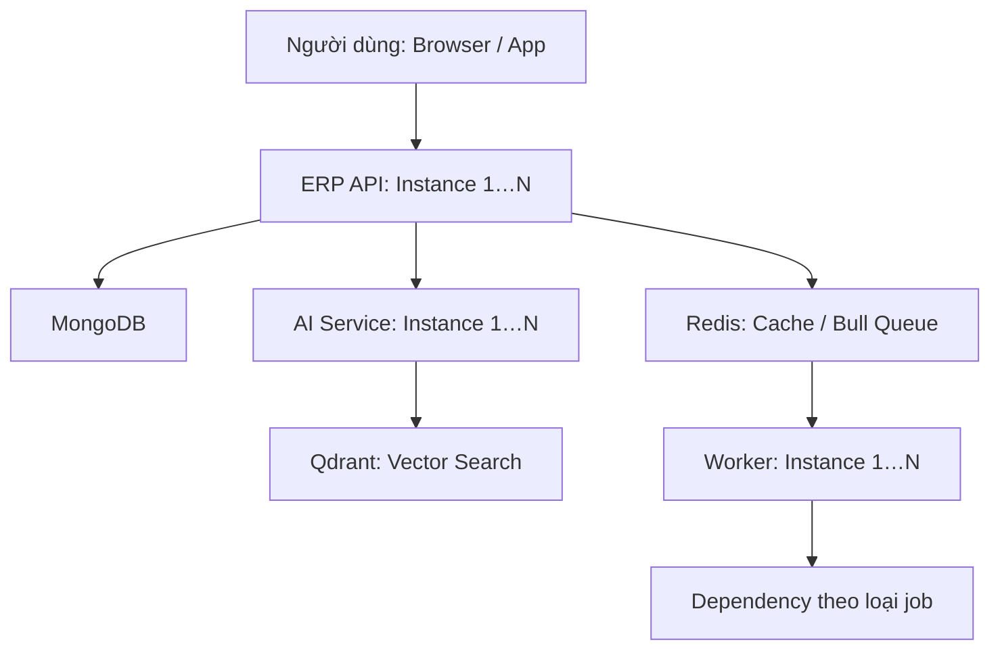
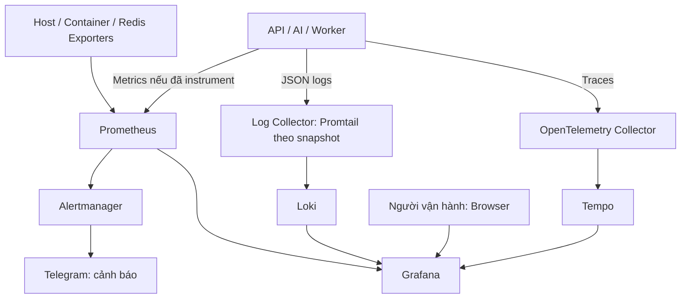
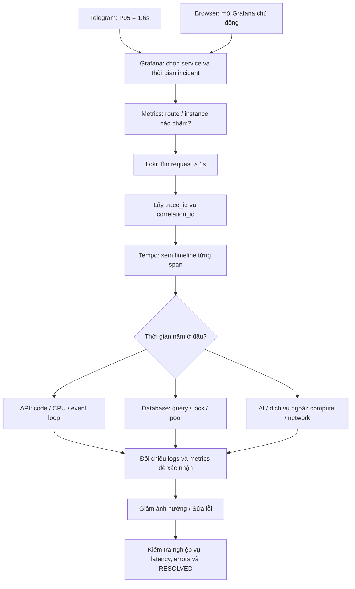
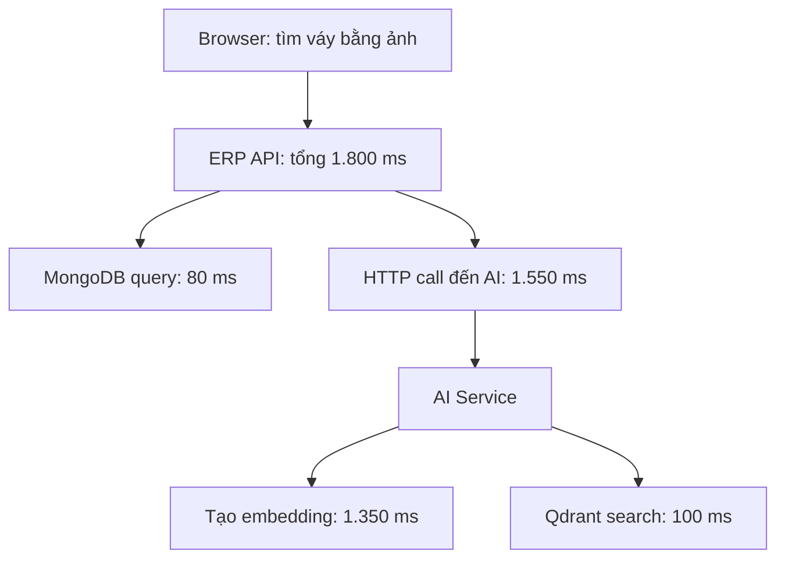
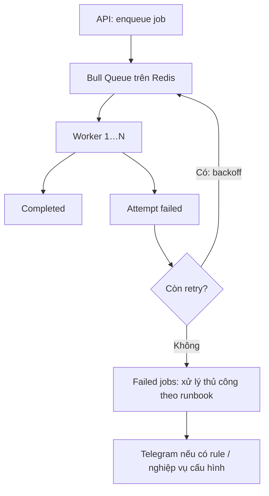

# Distributed System Monitoring — System Architecture & Incident Runbook

Ngày: 05/11/2026 · Cập nhật Q&A: 06/11/2026 · Ví dụ áp dụng: Kygo ERP API (NestJS), AI Service (FastAPI), MongoDB, Redis/Bull và Qdrant.

Mục tiêu: nhìn sơ đồ để hiểu hệ thống; từ alert Telegram hoặc Grafana trên browser tìm được endpoint chậm, request cụ thể và bước gây chậm; xử lý rồi xác nhận phục hồi.

> Phạm vi: tài liệu hướng dẫn dựa trên hai tài liệu Kygo đã cung cấp và nội dung trao đổi. Không phải kết quả kiểm tra production. Các liên kết, pipeline và thay đổi đã deploy cần được xác minh. Instance 1…N thể hiện khả năng mở rộng; worker là vai trò logic, có thể chạy cùng tiến trình API.

## 1. System Architecture

### 1.1 Luồng nghiệp vụ



Redis cache và queue là hai cách dùng khác nhau. Worker nhận job từ queue; không phải mọi request API đều đi qua worker. Một số job AI có thể gọi AI Service; job gửi thông báo gọi Telegram.

### 1.2 Luồng monitoring



Mũi tên metrics biểu diễn luồng dữ liệu: Prometheus chủ động scrape API/exporters. Snapshot xác nhận có các container này, chưa chứng minh mọi pipeline đang ingest đúng. Metrics AI/worker và metrics queue cần cấu hình riêng nếu chưa có.

| Thành phần | Vai trò | Câu hỏi trả lời |
|---|---|---|
| Prometheus | Lưu metrics và đánh giá alert rules | Route nào chậm, bao nhiêu request, lỗi tăng không? |
| Alertmanager | Group, deduplicate, route thông báo | Gửi cảnh báo đến Telegram như thế nào? |
| Grafana | Giao diện browser cho metrics/logs/traces | Mở ở đâu để điều tra? |
| Loki | Lưu và tìm JSON logs | Request/job đã xảy ra chuyện gì? |
| Tempo | Lưu và tìm distributed traces | Thời gian mất ở service/bước nào? |
| OpenTelemetry Collector | Nhận và chuyển telemetry theo pipeline | Traces từ ứng dụng đi đến đâu? |
| Exporters | Xuất metrics host/container/Redis | Tài nguyên hay dependency có bất thường? |

## 2. Hiểu alert Telegram

```text
FIRING
ApiHighP95Latency (warning)
API P95 latency > 1s
P95 latency is 1.6s over the last 5 minutes.
```

| Nội dung | Ý nghĩa |
|---|---|
| FIRING | Điều kiện cảnh báo đã thỏa mãn, bao gồm thời gian giữ nếu có |
| warning | Mức độ do cấu hình; không tự động có nghĩa hệ thống ngừng hoạt động |
| P95 = 1.6s | Phân vị 95 của latency khoảng 1,6 giây, không phải thời gian trung bình |
| Last 5 minutes | Cửa sổ dữ liệu dùng để tính P95 |
| Threshold > 1s | Giá trị đã vượt ngưỡng cấu hình |

Histogram ước lượng P95 dựa vào buckets. Giá trị 1,6 giây không nhất thiết là latency đo trực tiếp của một request. Alert chưa chỉ ra endpoint hoặc dependency gây chậm.

Tài liệu tracing ghi rule có `for: 5m`: P95 tính trên cửa sổ 5 phút phải liên tục vượt ngưỡng trong 5 phút mới FIRING. Cần đối chiếu rule production. Khi traffic thấp, xem cả số request và số request > 1 giây để đánh giá mức ảnh hưởng.

## 3. Flow điều tra: Telegram hoặc browser



| Bước | Thao tác trên browser | Kết quả cần có |
|---|---|---|
| 1. Đánh giá ảnh hưởng | Overview: traffic, P95/P99, 5xx, availability | Một route hay toàn hệ thống; mức ảnh hưởng người dùng |
| 2. Khoanh vùng | API dashboard theo route/method, rồi instance | Endpoint/replica bất thường; có trùng deploy không |
| 3. Tìm request | Loki, đúng khoảng incident, lọc duration > 1000 ms | Một số request chậm cùng IDs |
| 4. Xem trace | Bấm trace_id để mở Tempo | Span mất nhiều thời gian và quan hệ các service |
| 5. Kiểm chứng | Logs + host/container/dependency metrics | Bằng chứng cho nguyên nhân, không chỉ tương quan |
| 6. Giảm ảnh hưởng | Rollback khi có bằng chứng liên quan deploy; hạn chế tải phần quá tải | Chức năng quan trọng ổn định trở lại |
| 7. Sửa và xác nhận | Kiểm tra nghiệp vụ, traffic, errors, latency qua nhiều cửa sổ | Phục hồi thực tế; ghi lại nguyên nhân và hành động |

Luôn giữ đúng khoảng thời gian khi chuyển dashboard → logs → traces. Không chỉ xem tài nguyên hiện tại sau khi incident đã qua. RESOLVED chưa đủ nếu traffic đã biến mất hoặc metrics bị mất.

## 4. Ví dụ: tìm váy bằng ảnh bị chậm

Các số sau là ví dụ cho một request, không phải số đo production hay chính giá trị P95.



Kết luận ban đầu: phần lớn thời gian của request nằm trong lời gọi AI, cụ thể là tạo embedding. Chưa thể kết luận CPU thiếu hay model loading nếu chưa xem bằng chứng bổ sung.

Không cộng span cha với span con: API 1.800 ms đã bao gồm lời gọi AI. Các bước song song cũng có thể chồng thời gian. So sánh nhiều trace để xác nhận đây là nút thắt phổ biến.

| Bằng chứng tiếp theo | Hướng xử lý phù hợp |
|---|---|
| AI CPU cao, nhiều tác vụ cùng chạy | Giới hạn concurrency, backpressure hoặc tăng năng lực xử lý |
| Chậm ở request đầu sau restart | Kiểm tra model loading và warm-up |
| Mongo query quét nhiều document | Xem explain, index, query shape |
| Nhiều query nhỏ lặp lại | Kiểm tra N+1, gom query |
| Chờ connection lâu | Kiểm tra pool saturation, query giữ connection lâu |
| Dependency timeout tăng | Kiểm tra network, timeout budget và cơ chế giảm ảnh hưởng |
| Chỉ một replica chậm | So sánh resource, version, cấu hình và lưu lượng giữa replicas |

Không tự động retry mọi request chậm: có thể làm tăng tải hoặc tạo side effect trùng. Tài liệu Kygo ghi các lời gọi API → AI hiện không tự động retry.

## 5. Queries dùng khi điều tra Kygo

Tên metric, labels và route dưới đây dựa trên tài liệu tracing. Kiểm tra datasource và dữ liệu thực tế trước khi dùng.

### 5.1 Prometheus: P95 theo route

```promql
histogram_quantile(
  0.95,
  sum by (le, route) (
    rate(http_request_duration_seconds_bucket{
      job="kygo-erp-api",
      route!~"/metrics|/ping|/health|/healthcheck|/health/password-reset"
    }[5m])
  )
)
```

Để điều tra replica, giữ thêm label `instance` trong `sum by` nếu label đó phân biệt đúng các replica. Không lấy trung bình P95 của từng replica để tính P95 toàn service.

### 5.2 Prometheus: số request và số request chậm

```promql
sum by (route) (
  increase(http_request_duration_seconds_count{job="kygo-erp-api"}[5m])
)
```

```promql
sum by (route) (
  increase(http_request_duration_seconds_count{job="kygo-erp-api"}[5m])
)
-
sum by (route) (
  increase(http_request_duration_seconds_bucket{
    job="kygo-erp-api", le="1"
  }[5m])
)
```

Query thứ hai đếm ước lượng request > 1 giây theo route. Khi đọc kết quả, loại monitoring routes tương tự query P95 để cùng phạm vi.

### 5.3 Loki: request nghiệp vụ chậm

```logql
{service="kygo-erp-api"} |= "Request completed"
| json
| route !~ "/metrics|/ping|/health|/healthcheck|/health/password-reset"
| duration_ms > 1000
| line_format "{{.duration_ms}}ms {{.status_code}} {{.operation}} cid={{.correlation_id}} trace={{.trace_id}}"
```

`service="kygo-erp-api"` là stream label container; JSON field service của API là `kygo-api`. Sau parse, field trùng tên có thể mang hậu tố `_extracted`.

### 5.4 Loki: theo một logical operation xuyên service

Thay chuỗi mẫu bằng correlation ID của request/job cần tìm.

```logql
{service=~"kygo-erp-api|kygo-ai-service"}
|= "16dd8408-bd28-4108-bdee-5ed64e38645e"
| json
```

### 5.5 Tempo: theo correlation ID

```traceql
{ span.kygo.correlation_id = "16dd8408-bd28-4108-bdee-5ed64e38645e" }
```

Hoặc mở trực tiếp trace bằng trace_id lấy từ Loki. Cần cấu hình Grafana derived fields/correlation để có link bấm từ log sang trace.

## 6. IDs và trường hợp thiếu trace

| ID | Dùng để làm gì? | Đặc điểm trong Kygo |
|---|---|---|
| trace_id | Theo một trace qua nhiều service | OTel quản lý; HTTP truyền context bằng traceparent |
| span_id | Nhận diện một bước trong trace | Ví dụ HTTP call, query hoặc tạo embedding |
| correlation_id | Gom logs của một logical operation | Có thể nối nhiều trace của các lần retry job |
| jobId | Nhận diện job | Kết hợp queue, attempt, status khi điều tra |

HTTP API → AI thường nằm trong cùng trace khi propagation và SDK hoạt động. Background job Kygo tạo root trace mới cho mỗi attempt, liên kết producer bằng span link; correlation ID giữ nguyên giữa các attempt của job có telemetry.

Nếu có trace_id trong log nhưng Tempo không thấy: kiểm tra sampling, SDK, Collector export, Tempo ingest và retention. Nếu SDK tắt thì có thể không có trace_id; dùng correlation_id để tìm logs. Request/job cũ trước thay đổi telemetry có thể không có liên kết đầy đủ.

## 7. Monitor queue và worker

API trả 202 nhanh chưa chứng minh job đã hoàn tất. Cần theo dõi cả phần xử lý nền.



| Signal | Ý nghĩa cần điều tra |
|---|---|
| Waiting count + tuổi job lâu nhất | Backlog tăng và người dùng chờ bao lâu |
| Active count + thời gian xử lý | Worker bận hay bị kẹt |
| Failed/retry rate | Lỗi dependency hoặc lỗi dữ liệu |
| Completion rate | Có tiến triển thực sự hay không |
| Worker heartbeat / replicas sống | Worker ngừng hoạt động |
| Redis memory, eviction, connection errors | Queue/cache có vấn đề hạ tầng |

Queue metrics và alert cần instrument riêng; không mặc định đã có từ API latency dashboard. Khi replay job, kiểm tra idempotency và side effect trước.

## 8. Alert Telegram đề xuất

```text
🔥 FIRING — ApiHighP95Latency
Severity: warning
Environment: production
Service: kygo-api

P95: 1.6s
Threshold: > 1s
Window: 5 minutes
Scope: toàn bộ API nghiệp vụ

1. Dashboard → xác định route chậm
2. Logs → tìm request > 1s
3. Trace → xác định bước chậm

API Dashboard: <link thực tế>
Slow Request Logs: <link thực tế>
Runbook: <link thực tế>
```

Đây là template, chưa cấu hình alert hay tạo links. Dashboard/log links nên chứa service và khoảng thời gian. Rule tổng hợp toàn API không thể tự nêu route chậm; muốn alert theo route cần giữ label route trong expression và kiểm soát số alert.

## 9. Các điểm cần xác nhận riêng cho Kygo

- Tài liệu ghi rule cũ có gộp monitoring routes; `/metrics` từng chậm do readiness probes. Đã có thay đổi code/config được ghi nhận nhưng chưa xác nhận deploy production.
- Chưa đủ bằng chứng kết luận `/metrics` gây alert mẫu. Cần xem volume và histogram trong đúng incident window.
- Histogram cũ có khoảng bucket 1–2,5 giây nên P95 trong khoảng này có độ phân giải hạn chế.
- Kiểm tra API/AI có trace mới; Loki → Tempo link hoạt động với request được sampled.
- Kiểm tra Prometheus targets, pipeline logs/traces và kênh Telegram; container Up không đủ chứng minh monitoring hoạt động.
- Theo dõi chính hệ thống monitoring: scrape failures, Collector export failures, dữ liệu Loki/Tempo mới và việc nhận cảnh báo.

## 10. Interview Questions & Simple Answers

Các câu trả lời mẫu dùng tiếng Anh đơn giản, thường 3–4 câu. Với tình huống giả định, dùng “I would”; chỉ đổi sang kinh nghiệm thực tế khi bạn đã làm và có thể giải thích bằng chứng. Các biện pháp dưới đây là cách tiếp cận đề xuất, không khẳng định tất cả đã được triển khai trong Kygo.

### A. Understanding monitoring

**1. How do you monitor a distributed system?**

I monitor request traffic, errors, and response time for each service. I also check CPU, memory, databases, and background jobs. I use metrics to find problems, traces to find the slow step, and logs to understand what happened.

**2. What is the difference between metrics, logs, and traces?**

Metrics show numbers and trends, such as error rate or P95 latency. Logs describe individual events, such as a failed database query. Traces show the path of one request across services and how long each step takes. I use all three together.

**3. How does an alert reach Telegram?**

Prometheus collects metrics and checks alert rules. When a rule meets its conditions, it sends an alert to Alertmanager. Alertmanager groups related alerts and sends a message to Telegram. I include a dashboard link so I can start checking quickly.

**4. What does P95 latency of 1.6 seconds mean?**

It means about 95 percent of the measured requests took 1.6 seconds or less. The slowest requests took longer. It is not the average response time. If it comes from histogram buckets, the value is an estimate.

**5. Why do you check P95 instead of only average latency?**

An average can hide slow requests. Most requests may be fast while some users wait several seconds. P95 helps me see that slower experience. I also check request count and P99 because P95 does not show every slow request.

**6. What would you do after receiving a high-latency alert?**

First, I would check which routes and users are affected. Then I would find slow requests in the logs and open their traces. I would compare the slow steps with database and server metrics. After reducing the impact, I would fix the cause and verify recovery.

**7. How do you know which service causes the delay?**

I follow the trace of a slow request and look at the time spent in each service. For example, the API may spend most of its time waiting for the AI service. Then I check the AI service's own steps, logs, and resource usage. I compare several requests before drawing a conclusion.

**8. What is the difference between a trace ID and a correlation ID?**

A trace ID connects the spans in one trace. A correlation ID helps me find logs for one logical operation. In Kygo's job design, retries can have separate traces but share the same correlation ID. This helps me follow the job across attempts.

**9. Why might a trace ID exist in logs but not in Tempo?**

The trace may not have been sampled, or it may have expired. There may also be a problem sending traces through the Collector to Tempo. I would check those settings and pipeline errors. Meanwhile, I would use the correlation ID to search the logs.

**10. Is a healthy container enough to prove the system works?**

No. A running container may still fail to serve requests or connect to a database. I check readiness, real request errors, and response time. I also use a small end-to-end check for an important user flow.

### B. Handling service and database failures

**11. What if one service is down but other services are still running?**

I would check which user flows depend on that service. I would use timeouts so other services do not wait forever. If the feature is optional, I would disable it or provide a safe fallback. For a required step, I would return a clear error and avoid reporting false success.

**12. What if the AI service is down in Kygo?**

I would keep normal product browsing available if it does not depend on AI. Image search could show a temporary error and suggest normal search. I would use a timeout and limit repeated calls to the failing service. Booking should not depend on image search being available.

**13. Would you retry every failed request?**

No. I retry only failures that may be temporary, and only when retrying is safe. I use a small retry limit and a delay between attempts. For payments or other writes, I need an idempotency key or another duplicate check. A timeout does not prove that the first attempt did nothing.

**14. What are backoff and jitter?**

Backoff means waiting longer between retries. Jitter adds a small random delay. This prevents many clients from retrying at exactly the same time. I also limit the total number of attempts.

**15. What is a circuit breaker, in simple terms?**

It temporarily stops calls to a service that keeps failing. This helps protect both the caller and the failing service. After a short time, it allows a few test calls. If they succeed, normal calls can resume.

**16. What would you check if the database became slow?**

I would check slow queries, indexes, locks, and connection pool usage. A trace helps me see whether time is spent running a query or waiting for a connection. For MongoDB, I would inspect the query plan and documents examined. I would fix the bottleneck before simply adding more connections.

**17. What if Redis goes down?**

I first check what Redis is used for. If it is only a cache, reads may fall back to the database, with limits to protect the database. If Redis holds Bull jobs, enqueueing and job processing may be affected. Recovery depends on persistence and failover, so I would check job state before replaying anything.

**18. What if one API replica is slow but the others are fine?**

I would compare its CPU, memory, version, and traffic with the other replicas. If enough healthy capacity remains, I would remove the affected replica from traffic while investigating. I would check whether it is blocked, restarting, or using different settings. I would keep useful logs before restarting it when possible.

**19. The problem started after deployment. Would you roll back immediately?**

I would check the timing, affected version, and user impact. If the new version is likely responsible and rollback is safe, I would roll back to reduce the impact. I would check compatibility with database changes first. Then I would confirm that errors and latency improve.

### C. Handling queue and worker failures

**20. The API returns 202. Does that mean the job succeeded?**

No. It means the request was accepted for background processing. I still need to track whether the job is waiting, running, completed, or failed. The user should be able to check the result. I do not report the work as completed just because the API returned quickly.

**21. What would you monitor for a queue?**

I monitor waiting jobs, the age of the oldest waiting job, and processing time. I also track failures, retries, and completion rate. A long queue can be normal during a short traffic spike. Growing wait time with low completion rate is more concerning.

**22. What happens if a worker crashes while processing a job?**

The queue may detect the stalled job and make it available again, depending on its configuration. This means the job can run more than once. I make the handler idempotent and check existing results before repeating side effects. I also monitor stalled jobs and repeated failures.

**23. What if the worker crashes after charging a customer but before marking the job complete?**

I cannot assume the charge failed. On retry, I would reuse the same payment idempotency key and check the provider's result. I would then update our local state. If the outcome is unclear, I would reconcile it instead of creating a new charge blindly.

**24. What do you do when a job reaches its retry limit?**

I keep the failed job and record the reason, job ID, and attempt count. I alert the team when the failure needs action. After fixing the cause, I replay the job only after checking that it is safe. I keep a record of the replay and its result.

**25. Would adding more workers always solve a backlog?**

No. More workers help only if the dependency has enough capacity. If the database or external API is already overloaded, more workers can make things worse. I check the bottleneck first, then adjust worker count, concurrency, or rate limits.

### D. Alert quality, recovery, and trade-offs

**26. How do you avoid too many alerts?**

I alert on problems that need action, especially user impact. I use suitable time windows and group related alerts. I separate warnings from urgent failures. Each alert should explain what happened and where to start checking.

**27. What if P95 is high but traffic is very low?**

I would check how many requests were measured and look at the actual slow requests. With low traffic, a few requests can change P95 a lot. I would also check whether health or metrics endpoints were included. I would investigate the impact before changing the threshold.

**28. How do you know the incident is really resolved?**

I check that real user requests succeed and latency returns to a normal level. I also check error rate, traffic, and queue wait time. A resolved alert alone is not enough because traffic or metrics may have disappeared. I watch the system for a suitable period after the change.

**29. What if the monitoring system itself fails?**

Missing data does not mean the application is healthy. I monitor scrape failures and telemetry export errors. I would use an independent uptime check or a separate alert path for a major monitoring failure. During the incident, I would also inspect application and infrastructure health directly.

**30. Would you store every log and every trace?**

Not always. Keeping everything increases cost and can add overhead. I choose retention and trace sampling based on traffic and investigation needs. With head sampling, some slow or failed traces may be missed. Tail sampling can keep traces based on their result, but it adds processing and operational cost.

**31. Should you use user IDs or trace IDs as metric labels?**

Usually no, because they create too many unique time series. I use labels such as service, route template, method, and status code. I keep individual IDs in logs and traces. This makes metrics cheaper and easier to query.

**32. What do you do after an incident?**

I write down the impact, timeline, cause, and recovery steps. I explain what helped and what made the investigation difficult. Then I add practical follow-up work, such as a missing alert, a timeout, or a query fix. The goal is to reduce the chance and impact of the same failure.

### E. One-minute answer: explain your overall approach

**33. Can you explain your monitoring and failure-handling approach?**

I start with user impact: are requests failing, slowing down, or waiting too long? I use metrics to identify the affected service or route. Then I use logs and traces to find the failing or slow step. I reduce the impact with a safe action, such as a rollback or a temporary feature limit. I use bounded retries only when they are safe, and I make background jobs idempotent. Finally, I verify recovery with real requests and record how to prevent the same issue.

### Quick practice: useful phrases

- “First, I check the user impact.”
- “Then, I narrow it down to a service or route.”
- “I compare the trace with logs and metrics.”
- “A timeout does not mean the operation failed.”
- “I would not retry it blindly.”
- “I reduce the impact before investigating further.”
- “I verify recovery with real user requests.”


## 11. Nguồn và giới hạn

- Kygo-Services-Infrastructure.md: snapshot container ngày 23/10/2026, chưa kiểm chứng kết nối production.
- distributed-tracing.md: hợp đồng IDs, logs, propagation, queries, thay đổi latency và các bước production verification còn lại.
- Prometheus — Histograms and summaries: https://prometheus.io/docs/practices/histograms/
- OpenTelemetry — Observability primer: https://opentelemetry.io/docs/concepts/observability-primer/

Tài liệu mô tả cách vận hành và điều tra; không triển khai hay thay đổi hạ tầng.
