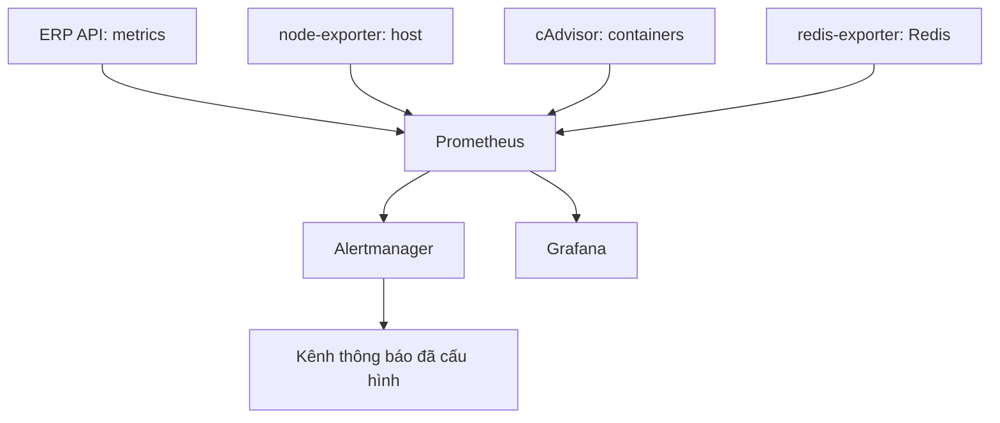
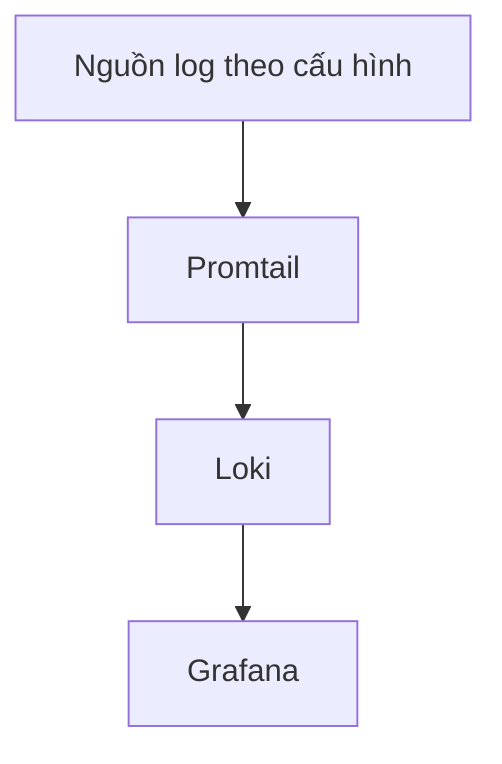
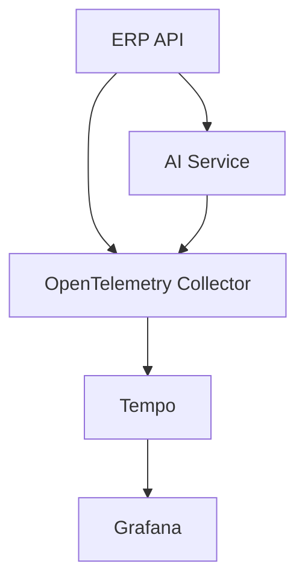

# Kygo Prom — Tài liệu service và hạ tầng

Ngày ghi nhận: 23/10/2026 (Việt Nam).

Nguồn: danh sách `docker ps` do chủ hệ thống cung cấp. Đây là ảnh chụp trạng thái tại thời điểm gửi, không phải kết quả kiểm tra trực tiếp server. Có 14 container đang Up; chỉ Qdrant và cAdvisor hiện nhãn healthy. Up không đồng nghĩa ứng dụng đã sẵn sàng hay các luồng dữ liệu đã hoạt động.

## 1. Tổng quan

| Nhóm | Số container | Thành phần |
|---|---:|---|
| Ứng dụng | 2 | ERP API, AI Service |
| Dữ liệu hỗ trợ | 2 | Redis, Qdrant |
| Metrics và cảnh báo | 6 | Prometheus, Alertmanager, cAdvisor, node-exporter, redis-exporter, Grafana |
| Logs | 2 | Promtail, Loki |
| Traces | 2 | OpenTelemetry Collector, Tempo |

Grafana được xếp vào nhóm metrics để đếm duy nhất một lần; thực tế là giao diện chung cho metrics, logs và traces khi đã cấu hình datasource tương ứng.

## 2. Danh mục container

Vai trò bên dưới mô tả mục đích của từng thành phần. Các tính năng cụ thể đang bật cần đối chiếu mã nguồn và cấu hình triển khai.

| Container | Image / phiên bản | Vai trò | Cổng hiển thị trong docker ps | Trạng thái lúc ghi nhận |
|---|---|---|---|---|
| `kygo-erp-api` | `root-kygo-erp-api` (không có tag phiên bản trong danh sách) | Backend nghiệp vụ ERP Kygo; xử lý API cho ứng dụng | Host IPv4/IPv6 `5001 → 5001/tcp` | Up 56 giây |
| `kygo-ai-service` | `root-kygo-ai-service` (không có tag phiên bản trong danh sách) | Dịch vụ AI; tiến trình Uvicorn chạy `app.main` | Host IPv4/IPv6 `8000 → 8000/tcp` | Up 25 giờ |
| `redis` | `redis:6-alpine` | Kho dữ liệu key-value; thường dùng cache, queue hoặc dữ liệu tạm; cách dùng thực tế cần xác nhận | Host IPv4/IPv6 `6379 → 6379/tcp` | Up 4 ngày |
| `kygo-qdrant` | `qdrant/qdrant:v1.13.6` | Vector database phục vụ lưu và tìm kiếm vector | `6333–6334/tcp`, không thấy host mapping | Up 5 ngày, healthy |
| `kygo-prometheus` | `prom/prometheus:v2.55.1` | Thu thập, lưu metrics và đánh giá alert rules | `9090/tcp`, không thấy host mapping | Up 5 ngày |
| `kygo-alertmanager` | `prom/alertmanager:v0.28.0` | Nhận alert; gom nhóm, loại trùng và chuyển đến kênh thông báo theo cấu hình | `9093/tcp`, không thấy host mapping | Up 25 giờ |
| `kygo-cadvisor` | `gcr.io/cadvisor/cadvisor:v0.49.1` | Xuất metrics tài nguyên container | `8080/tcp`, không thấy host mapping | Up 5 ngày, healthy |
| `kygo-node-exporter` | `prom/node-exporter:v1.8.2` | Xuất metrics CPU, RAM, disk và network của host theo mount/cấu hình | `9100/tcp`, không thấy host mapping | Up 5 ngày |
| `kygo-redis-exporter` | `oliver006/redis_exporter:v1.66.0` | Xuất metrics Redis cho Prometheus | `9121/tcp`, không thấy host mapping | Up 5 ngày |
| `kygo-grafana` | `grafana/grafana:11.4.0` | Dashboard và khám phá dữ liệu giám sát | Chỉ host loopback `127.0.0.1:3030 → 3000/tcp` | Up 23 giây |
| `kygo-promtail` | `grafana/promtail:3.3.2` | Agent đọc và chuyển log đến Loki theo cấu hình scrape | Không hiển thị cổng | Up 23 giây |
| `kygo-loki` | `grafana/loki:3.3.2` | Tiếp nhận, lưu và truy vấn log | `3100/tcp`, không thấy host mapping | Up 5 ngày |
| `kygo-otel-collector` | `otel/opentelemetry-collector-contrib:0.162.0` | Nhận, xử lý và chuyển tiếp telemetry theo pipeline | `4317–4318/tcp`, `55679/tcp`, không thấy host mapping | Up 25 giờ |
| `kygo-tempo` | `grafana/tempo:2.10.8` | Backend lưu và truy vấn distributed traces | Không hiển thị cổng | Up 25 giờ |

Ghi chú cổng: `4317` và `4318` thường dùng cho OTLP gRPC/HTTP; `6333` và `6334` thường dùng cho Qdrant HTTP/gRPC. Cổng listener thực tế, bao gồm `55679`, phải xem file cấu hình. Cột PORTS chỉ là metadata/mapping Docker, không chứng minh listener đang hoạt động.

## 3. Sơ đồ luồng giám sát cần đối chiếu cấu hình

Sơ đồ này là kiến trúc dự kiến theo vai trò thành phần, chưa xác nhận kết nối thực tế, Docker network hoặc trạng thái ingest.

### Metrics và cảnh báo



Các mũi tên từ exporter/API biểu diễn luồng dữ liệu metrics; Prometheus chủ động scrape các endpoint. Cần kiểm tra API có được scrape, metrics route nào được dùng và có loại `/metrics` khỏi thống kê latency nghiệp vụ hay chưa.

### Logs



Cần xác nhận Promtail đọc những container/file nào, nhãn service, parsing log và việc giữ lại `trace_id`, `span_id`, `request_id`.

### Traces



API gọi AI và truyền trace context là quan hệ cần xác minh từ ứng dụng. Collector có thể nhận các loại telemetry khác nếu được cấu hình; danh sách container chưa cho biết pipeline nào đang bật. Việc chuyển từ log sang trace trong Grafana còn cần datasource/derived fields hoặc correlations phù hợp.

## 4. Phạm vi truy cập mạng

| Phạm vi binding xác nhận được | Service | Ý nghĩa |
|---|---|---|
| Tất cả interface IPv4 và IPv6 của host | ERP API 5001, AI Service 8000, Redis 6379 | Có host port binding; truy cập từ Internet còn phụ thuộc firewall, routing và các lớp mạng khác |
| Loopback IPv4 của host | Grafana 3030 | Truy cập trên host tại `http://127.0.0.1:3030`; truy cập qua domain/proxy/SSH tunnel cần cấu hình bổ sung |
| Không thấy publish host port | 10 container còn lại | Không có host port mapping trong danh sách; không đủ bằng chứng kết luận network isolation hoặc service chỉ truy cập được nội bộ |

Redis đang bind `0.0.0.0:6379` và `[::]:6379`. Khi rà soát triển khai, cần xác nhận việc publish này có cần thiết và firewall/authentication thực tế đang bảo vệ ra sao. Tương tự, xác nhận API/AI được truy cập trực tiếp hay qua reverse proxy.

## 5. Dữ liệu, cấu hình và sao lưu

Danh sách docker ps không thể hiện volumes, bind mounts, retention, credentials, giới hạn tài nguyên hoặc restart policy. Chưa thể xác nhận dữ liệu tồn tại sau khi recreate container.

| Thành phần | Thông tin cần bổ sung để vận hành |
|---|---|
| Redis | Vai trò cache/queue, RDB/AOF, volume, authentication, eviction policy, phương án phục hồi nếu chứa job |
| Qdrant | Collection, embedding model/dimension, volume, snapshots và cách phục hồi |
| Prometheus | Scrape targets, rules, TSDB volume, retention, scrape interval |
| Alertmanager | Routing, receivers, silence, cấu hình dedup và secret kênh thông báo |
| Loki / Promtail | Log sources, labels, storage, retention, parsing và vị trí file cấu hình |
| Collector / Tempo | OTLP endpoints, receivers/processors/exporters, sampling, storage và retention traces |
| Grafana | Datasources, dashboards, provisioning, volume, tài khoản truy cập |
| ERP API / AI Service | Commit/image digest, env names, health endpoints, dependencies, timeouts, resource limits |

## 6. Lệnh kiểm tra vận hành

Chạy trên server Kygo. Những lệnh dưới đây chỉ đọc thông tin và không thay đổi container.

```bash
# Danh sách container và tài nguyên hiện tại
docker ps
docker stats --no-stream

# Log gần đây của hai ứng dụng
docker logs --since 15m --tail 200 kygo-erp-api
docker logs --since 15m --tail 200 kygo-ai-service

# Log hệ thống quan sát
docker logs --since 15m --tail 100 kygo-otel-collector
docker logs --since 15m --tail 100 kygo-tempo
docker logs --since 15m --tail 100 kygo-promtail
docker logs --since 15m --tail 100 kygo-alertmanager

# Xem mount; lặp lại cho các service có dữ liệu cần giữ
docker inspect kygo-qdrant --format '{{json .Mounts}}'
docker inspect redis --format '{{json .Mounts}}'

# Xem network và restart policy của API
docker inspect kygo-erp-api --format '{{json .NetworkSettings.Networks}}'
docker inspect kygo-erp-api --format '{{json .HostConfig.RestartPolicy}}'
```

Trong Grafana, đối chiếu datasource Prometheus/Loki/Tempo và kiểm tra truy vấn có dữ liệu mới. Trong Prometheus, kiểm tra targets có trạng thái UP và alert rules. Một lần gọi API cần được đối chiếu giữa log và trace để xác minh end-to-end; container Up chưa đủ cho kiểm tra này. Khi chia sẻ log/cấu hình, loại bỏ token, mật khẩu và dữ liệu khách hàng.

## 7. Những điểm chưa xác định

- MongoDB, frontend customer/admin, reverse proxy và dịch vụ email không xuất hiện trong danh sách này. Chưa thể kết luận chúng không tồn tại: có thể chạy ngoài Docker, ngoài host hoặc ở dịch vụ khác.
- Chưa biết domain, Docker Compose service keys, mạng, mount paths, healthcheck và restart policy. Tên container không nhất thiết trùng service key trong Compose.
- Chưa xác minh API → AI, ứng dụng → Redis/Qdrant, trace propagation và các luồng giám sát.
- Chưa xác minh dashboard, alert P95, việc tính `/metrics` trong latency, hay kênh nhận cảnh báo.
- API, Grafana và Promtail có uptime ngắn trong snapshot. Cần lịch sử deploy/restart để biết nguyên nhân; chưa đủ bằng chứng kết luận crash.
- Image ứng dụng chưa thể hiện phiên bản; Redis dùng tag `6-alpine`, chưa xác định patch version. Khi bàn giao triển khai nên ghi commit và image digest để truy xuất chính xác bản đang chạy.

## 8. Thông tin bàn giao cần chốt

1. Vị trí Compose/config và chủ quản từng service.
2. Domain/reverse proxy, firewall và các cổng thực sự cần publish.
3. Volumes, backup, retention và quy trình restore đã thử nghiệm.
4. Datasources, scrape targets, log sources, trace pipeline và nơi nhận alert.
5. Quy trình deploy/rollback, image digest và healthcheck của ứng dụng.

Tài liệu phản ánh snapshot ngày 23/10/2026. Cập nhật bảng service khi đổi image, port, volume hoặc cấu hình triển khai; uptime trong tài liệu chỉ có ý nghĩa tại thời điểm ghi nhận.
