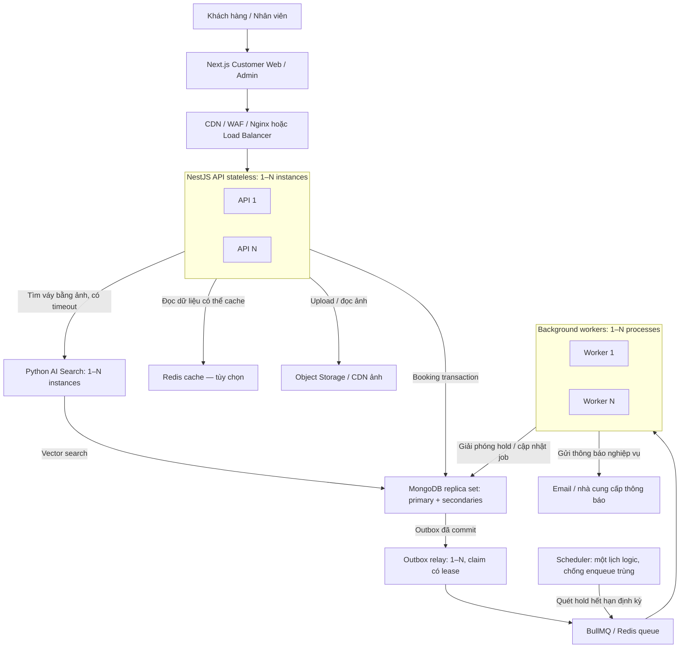
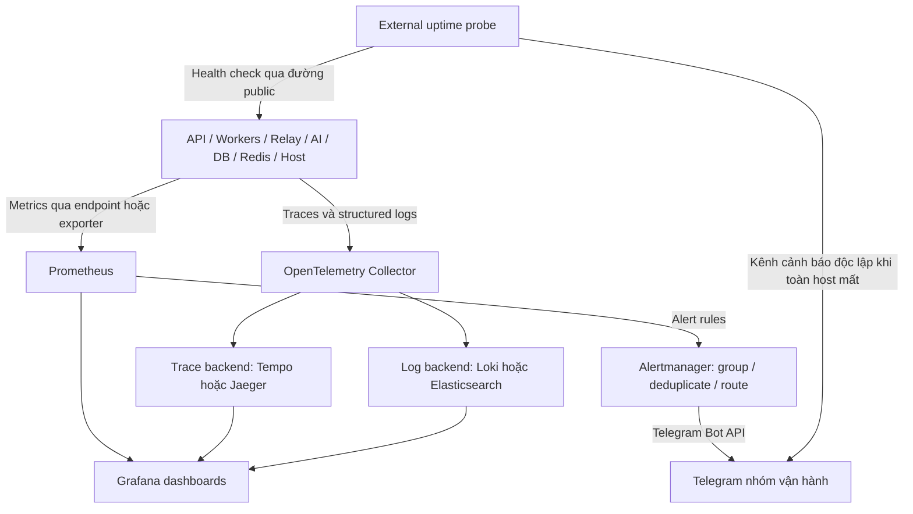

# Kygo Prom — Chống đặt trùng lịch thuê váy

Tài liệu thiết kế và ôn phỏng vấn • 05/11/2026

Đây là phương án thiết kế đề xuất, không phải xác nhận về code đang chạy của Kygo.

## 0. System Architecture

Kiến trúc đề xuất để dễ hình dung và mở rộng. Bắt đầu với 1 API và 1 worker; các nhóm 1–N biểu diễn khả năng scale, không khẳng định đang triển khai N instance. MongoDB là lựa chọn hiện tại; PostgreSQL là phương án thay thế trong tài liệu, không ghi booking đồng thời vào cả hai database.

### 0.1. Luồng request và dữ liệu



Luồng đặt váy: API kiểm tra request → transaction lưu order, reservation và outbox → commit → trả kết quả. Relay chuyển outbox sang queue; worker xử lý việc nền. Các thao tác liên quan đến giữ lịch phải dùng cùng cơ chế bảo vệ database ở phần sau, kể cả khi chạy trong worker.

Outbox là phần mở rộng được khuyến nghị nếu cần bảo đảm không mất job giữa commit DB và enqueue. Relay dùng claim/lease, job ID ổn định và consumer idempotent: sự cố vẫn có thể làm job được phát hoặc xử lý lại. Không coi queue là lớp chống double booking.

Redis cache và Redis queue được phân biệt theo vai trò. Khi production cần cách ly sự cố/bộ nhớ, tách instance; dữ liệu queue không nên bị eviction như cache. Availability hiển thị có thể cũ; quyết định giữ lịch cuối cùng luôn ở database primary.

### 0.2. Monitoring và cảnh báo Telegram



Chọn một trace backend và một log backend theo môi trường, không cần cài tất cả các lựa chọn. Trace ID nối request với log; truyền thêm context qua job để lần theo từ API sang worker. Không dùng orderId, userId hoặc traceId làm label metrics vì cardinality cao.

Kênh cảnh báo vận hành: **Telegram**. Alertmanager gửi qua Telegram Bot API; bot token lưu trong secret. External probe nên ở ngoài host ứng dụng để vẫn phát hiện được khi cả VPS hoặc monitoring trên VPS ngừng hoạt động.

| Nhóm | Theo dõi | Ví dụ điều kiện cảnh báo cần hiệu chỉnh theo baseline |
|---|---|---|
| API | p95 latency, 5xx, timeout, request rate | p95 > 2 giây trong 5 phút, đủ số request để đánh giá |
| Booking | write conflict, retry, retry hết deadline | Retry hết deadline tăng; tách hết lịch hợp lệ khỏi lỗi hệ thống |
| Worker / Queue | tuổi job lâu nhất, waiting, failed, stalled | Job chờ quá thời hạn nghiệp vụ; job hết retry |
| Hold / Outbox | hold hết hạn chưa xử lý, outbox lag | Độ trễ vượt SLA; relay không tiến triển |
| Database | slow query, pool wait, replication lag | Pool gần cạn hoặc transaction lỗi tăng |
| Redis / Host | memory, eviction, CPU, RAM, disk | Queue Redis eviction > 0; disk sắp đầy |

Một alert nên có tên dịch vụ, môi trường, mức độ, thời điểm, metric hiện tại và link dashboard/runbook. Group và giới hạn tần suất để tránh Telegram bị ngập tin; gửi thông báo resolved khi phục hồi.

### 0.3. Scale component nào, khi nào?

| Component | Bắt đầu | Mở rộng | Giới hạn cần nhớ |
|---|---|---|---|
| NestJS API | 1 instance | 1–N sau load balancer, health check và graceful shutdown | Stateless; tăng instance làm tăng tổng DB connections |
| Workers | 1 process | Worker 1–N cùng queue; chỉnh concurrency mỗi worker | Job có thể chạy lại, phải idempotent; giới hạn tải DB/provider |
| Outbox relay | 1 process | 1–N với claim/lease | Tránh nhiều relay phát không kiểm soát cùng bản ghi |
| Scheduler | 1 lịch logic | HA có leader/lock hoặc cơ chế lịch dùng chung | Không để mỗi API tự tạo cron giống nhau |
| Python AI | 1 instance | 1–N qua service endpoint/load balancer | Theo RAM/CPU và latency; tách inference nặng khỏi API |
| MongoDB | Replica set hỗ trợ transaction | Tối ưu index/pool trước; secondary phục vụ read phù hợp | Replica set tăng HA, không tự chia tải write; shard khi có bằng chứng cần |
| Redis queue | 1 instance có persistence phù hợp | HA/managed và kiểm tra khả năng tương thích BullMQ | Mất queue: phục hồi từ dữ liệu bền vững, reconcile; không bỏ qua durability |
| Monitoring | Có thể cùng VPS khi nhỏ | Tách host hoặc managed khi cần | Cùng host là cùng miền sự cố |

BullMQ hỗ trợ nhiều worker và concurrency trong từng worker. Scale dựa trên queue age, throughput và tài nguyên; thêm worker không chữa được contention trên cùng chiếc váy. Tổng connection pool của mọi API/worker phải nằm trong khả năng database.

Nếu triển khai phương án PostgreSQL, thay node MongoDB bằng PostgreSQL primary + standby; bỏ nhánh MongoDB vector search hoặc chọn dịch vụ tìm kiếm tương ứng. Booking vẫn dùng primary; standby tăng khả năng phục hồi, không tự tăng năng lực ghi.

## 1. Bài toán và quyết định

Một product đại diện cho một chiếc váy vật lý. Nếu một mẫu có nhiều chiếc, cần ID riêng cho từng chiếc để phân bổ lịch.

Hai khách không được giữ cùng chiếc váy trong các khoảng thời gian giao nhau. Hai đơn cùng ngày vẫn hợp lệ: đơn trước trả lúc 12h, đơn sau nhận lúc 13h, miễn váy đã được chuẩn bị xong.

Chốt: lưu khoảng thời gian theo giờ; MongoDB dùng transaction và ghi chung product; PostgreSQL dùng exclusion constraint. Không chia ngày vì sẽ chặn nhầm hai đơn cùng ngày nhưng khác giờ.

## 2. Quy tắc thời gian

- Lưu thời điểm UTC; nhập và hiển thị theo Asia/Ho_Chi_Minh.
- startAt < endAt; từ chối khoảng rỗng hoặc ngược.
- Khoảng chiếm dụng là [startAt, endAt): gồm đầu, không gồm cuối.
- endAt là lúc váy sẵn sàng cho khách sau, bao gồm giặt/kiểm tra. Giờ trả dự kiến có thể lưu riêng khi cần.
- Trả muộn là ngoại lệ vận hành: cảnh báo và xử lý booking sau; constraint không bảo đảm váy được trả đúng giờ.

Điều kiện hai khoảng giao nhau:

```js
existing.startAt < requested.endAt &&
existing.endAt > requested.startAt
```

| Đơn trước kết thúc | Đơn sau bắt đầu | Cho phép? |
|---|---|---|
| 12:00 | 11:00 | Không |
| 12:00 | 12:00 | Có |
| 12:00 | 13:00 | Có |
| Trả 12:00, chuẩn bị đến 14:00 | 13:00 | Không; endAt phải là 14:00 |

## 3. Schema MongoDB tối giản

```js
// products
{ _id: "DRESS_A", version: 0 }

// orders
{
  _id: "ORDER_01",
  customerId: "CUSTOMER_01",
  idempotencyKey: "request-unique-key",
  status: "PENDING_PAYMENT"
}

// reservations — startAt, endAt, expiresAt dùng BSON Date
{
  _id: "RES_01",
  productId: "DRESS_A",
  orderId: "ORDER_01",
  startAt: ISODate("2026-11-10T03:00:00Z"),
  endAt: ISODate("2026-11-12T05:00:00Z"),
  status: "HELD",
  expiresAt: ISODate("2026-11-05T10:10:00Z")
}
```

Reservation có các trạng thái HELD, CONFIRMED, CANCELLED, EXPIRED. expiresAt chỉ cần cho HELD. Tạo unique index trên idempotencyKey theo phạm vi nghiệp vụ; không đặt version unique. Index tra lịch có thể bắt đầu bằng productId, status, startAt; kiểm tra query plan theo dữ liệu thực tế.

## 4. MongoDB — transaction và điểm ghi chung

Pseudocode, chưa phải code production:

```js
await session.withTransaction(async () => {
  // Phải là thao tác thay đổi dữ liệu thực sự.
  const result = await products.updateOne(
    { _id: productId },
    { $inc: { version: 1 } },
    { session }
  );
  if (result.matchedCount !== 1) throw new Error("PRODUCT_NOT_FOUND");

  const now = new Date(); // Tính lại khi callback được retry.
  const overlap = await reservations.findOne({
    productId,
    startAt: { $lt: requestedEnd },
    endAt: { $gt: requestedStart },
    $or: [
      { status: "CONFIRMED" },
      { status: "HELD", expiresAt: { $gt: now } }
    ]
  }, { session });

  if (overlap) throw new Error("BOOKING_CONFLICT");

  await orders.insertOne(orderData, { session });
  await reservations.insertOne(reservationData, { session });
}, {
  readConcern: { level: "snapshot" },
  writeConcern: { w: "majority" },
  readPreference: "primary"
});
```

Tất cả thao tác trong callback dùng cùng session. Multi-document transaction cần replica set hoặc sharded cluster hỗ trợ transaction; không áp dụng nguyên trạng cho MongoDB standalone.

### Vì sao tăng version có tác dụng?

$inc riêng lẻ cho phép cả hai request tăng 0 → 1 → 2. Nó không tự chống đặt trùng. Trong thiết kế này, ghi chung document tạo xung đột giữa các transaction; transaction retry phải đọc lại lịch trước khi tạo reservation.

| Bước | Khách A | Khách B |
|---|---|---|
| Ghi product | Thay đổi version | Cạnh tranh cùng document |
| Kiểm tra và lưu | Thấy trống, tạo reservation, commit | Có thể bị abort vì xung đột |
| Retry | Đã hoàn tất | Đọc lại lịch; trùng thì từ chối, khác giờ thì tiếp tục |

Không phải mọi request đồng thời đều retry. Điều này phụ thuộc thời điểm thực thi. Cùng váy nhưng khác giờ vẫn có thể cạnh tranh; khác product không bị buộc cạnh tranh bởi cơ chế này.

### Điều kiện giữ đúng tính nhất quán

- Mọi đường tạo, đổi lịch, xác nhận, hủy và hết hạn reservation phải tuân theo giao thức ghi product trước.
- Chuyển sang chiếc váy khác hoặc đặt nhiều chiếc: ghi các product theo thứ tự ID nhất quán trong cùng transaction.
- Khi xác nhận hold, kiểm tra lại trạng thái và expiresAt. Không khôi phục hold đã hết hạn nếu lịch đã được khách khác lấy.
- Driver convenient transaction API có retry cho một số lỗi tạm thời; cấu hình deadline/retry hữu hạn theo driver đang dùng.
- Lỗi hết lịch là lỗi nghiệp vụ: không retry mù quáng.
- Không gọi thanh toán, gửi tin hay email trong callback có thể chạy lại. Thực hiện sau commit hoặc ghi outbox trong transaction.

## 5. PostgreSQL — exclusion constraint

Schema tối giản:

```sql
CREATE EXTENSION IF NOT EXISTS btree_gist;

CREATE TABLE products (
    id BIGSERIAL PRIMARY KEY
);

CREATE TABLE orders (
    id BIGSERIAL PRIMARY KEY,
    customer_id BIGINT NOT NULL,
    idempotency_key TEXT NOT NULL UNIQUE,
    status TEXT NOT NULL
);

CREATE TABLE reservations (
    id BIGSERIAL PRIMARY KEY,
    product_id BIGINT NOT NULL REFERENCES products(id),
    order_id BIGINT NOT NULL REFERENCES orders(id),
    start_at TIMESTAMPTZ NOT NULL,
    end_at TIMESTAMPTZ NOT NULL,
    status TEXT NOT NULL CHECK (
        status IN ('HELD', 'CONFIRMED', 'CANCELLED', 'EXPIRED')
    ),
    expires_at TIMESTAMPTZ,
    CHECK (start_at < end_at),
    CHECK (status <> 'HELD' OR expires_at IS NOT NULL),
    EXCLUDE USING gist (
        product_id WITH =,
        tstzrange(start_at, end_at, '[)') WITH &&
    ) WHERE (status IN ('HELD', 'CONFIRMED'))
);
```

Cùng product và giao nhau về thời gian thì constraint không cho cả hai reservation cùng tồn tại ở trạng thái giữ lịch.

Trong một transaction: tạo order → insert reservation → commit. Nếu có cạnh tranh, một thao tác có thể chờ kết quả transaction kia; nếu lịch xung đột đã commit, thao tác còn lại nhận exclusion violation (SQLSTATE 23P01). Rollback transaction rồi trả BOOKING_CONFLICT, ví dụ HTTP 409.

Không cần tăng version hoặc SELECT FOR UPDATE trên product chỉ để bảo vệ overlap. Query availability trước insert vẫn hữu ích cho UX, nhưng constraint mới là lớp bảo vệ cuối.

### Hold hết hạn

Constraint dựa trên status, không tự bỏ qua HELD chỉ vì expires_at đã qua. Job hoặc luồng đặt mới phải chuyển hold hết hạn sang EXPIRED. Không đặt now() vào predicate để kỳ vọng index tự cập nhật theo thời gian.

Xác nhận thanh toán và giải phóng hold phải cập nhật trạng thái có điều kiện trong transaction; có thể khóa reservation bằng SELECT FOR UPDATE rồi kiểm tra thời hạn. Nếu hold đã mất, không xác nhận mù quáng: thử giữ lại lịch an toàn hoặc chuyển xử lý hoàn tiền/ngoại lệ.

## 6. Failure handling và idempotency

| Tình huống | Cách xử lý |
|---|---|
| Cùng chiếc váy, trùng giờ | Chỉ một booking được giữ; request còn lại nhận conflict |
| Cùng chiếc váy, khác giờ | Cả hai hợp lệ; MongoDB có thể cần retry |
| Khách bấm lại hoặc API timeout | Dùng cùng idempotency key để tìm/trả đơn đã tạo; kiểm tra payload có khớp |
| Commit có kết quả chưa rõ | Dùng cơ chế commit retry của driver và tra idempotency key; không tạo đơn mới ngay |
| Hold hết hạn | Giải phóng trạng thái an toàn; không dựa vào TTL cleanup làm điều kiện đúng |
| Thanh toán đến sau khi hold hết hạn | Kiểm tra lại lịch; nếu không giữ được thì xử lý hoàn tiền/ngoại lệ |
| Đổi lịch bị trùng | Rollback; giữ nguyên lịch cũ |
| DB tạm lỗi, hết deadline retry | Trả lỗi tạm thời; không báo đặt thành công |

Chống trùng lịch và idempotency là hai việc khác nhau: một cơ chế bảo vệ tài nguyên; cơ chế kia bảo vệ cùng một yêu cầu khỏi tạo nhiều đơn.

## 7. Trade-off và lựa chọn

| Tiêu chí | MongoDB | PostgreSQL |
|---|---|---|
| Bảo vệ overlap | Giao thức transaction trong ứng dụng | Constraint trong database |
| Cạnh tranh cùng váy khác giờ | Có thể xảy ra trên product | Không bị serialize qua product chung |
| Độ gọn dữ liệu | Một reservation/khoảng thuê | Một reservation/khoảng thuê |
| Rủi ro chính | Có đường ghi bỏ qua giao thức | Sai trạng thái giữ lịch hoặc xử lý hold hết hạn |

Kygo đang dùng MongoDB: giữ stack hiện tại và triển khai giao thức transaction nhất quán. Không cần đổi database chỉ vì bài toán này. Với dự án dùng PostgreSQL, dùng exclusion constraint cho khoảng thời gian.

## 8. Các ca kiểm tra quan trọng

1. Nhiều request trùng chiếc váy và giờ: chỉ một reservation active được commit.
2. Cùng chiếc váy, khác giờ: cuối cùng đều đặt được trong điều kiện retry cho phép.
3. Hai khoảng chạm biên 12h: được phép; thêm thời gian chuẩn bị thì kiểm tra theo endAt đã điều chỉnh.
4. Gửi lại cùng idempotency key: không có thêm order.
5. Xác nhận hold đồng thời với hết hạn và booking mới: không có hai reservation active trùng nhau.
6. Đổi lịch thất bại: lịch cũ vẫn nguyên.

Theo dõi booking latency p95, write conflict/retry, retry hết hạn, lỗi DB và độ trễ giải phóng hold. Tách conflict nghiệp vụ khỏi lỗi hệ thống. Cảnh báo vận hành gửi về Telegram qua Alertmanager như phần System Architecture.

## 9. Câu trả lời phỏng vấn

“Tôi lưu lịch theo khoảng thời gian thực tế, bao gồm thời gian chuẩn bị váy. Với MongoDB, tôi dùng transaction: cập nhật chung document chiếc váy, kiểm tra overlap rồi tạo reservation và order. Khi có xung đột, transaction retry và đọc lại lịch. Đánh đổi là các booking cùng váy nhưng khác giờ vẫn có thể cạnh tranh.

Với PostgreSQL, tôi dùng exclusion constraint trên product ID và khoảng thời gian để database trực tiếp chặn overlap. Ở cả hai cách, tôi dùng idempotency key cho request và xử lý hold hết hạn an toàn.”

English:

“I model availability as a half-open time interval, including preparation time. In MongoDB, I update a shared product document inside a transaction, check overlapping reservations, and create the reservation and order together. Conflicting transactions retry and recheck availability. The trade-off is contention even for non-overlapping bookings on the same dress.

In PostgreSQL, I use an exclusion constraint on the product ID and time range. In both designs, I handle request idempotency and hold expiry separately.”

**Câu nhớ:** MongoDB — ghi chung váy rồi kiểm tra lịch. PostgreSQL — constraint chặn overlap. Cả hai — idempotency và hold expiry.

## 10. Tài liệu tham khảo

- BullMQ: [Concurrency](https://docs.bullmq.io/guide/workers/concurrency) và [Idempotent jobs](https://docs.bullmq.io/patterns/idempotent-jobs)
- Prometheus: [Telegram notification integration](https://prometheus.io/docs/alerting/latest/integrations/)

- MongoDB: [Production considerations — transactions](https://www.mongodb.com/docs/manual/core/transactions-production-consideration/)
- PostgreSQL: [Range types — constraints on ranges](https://www.postgresql.org/docs/15/rangetypes.html#RANGETYPES-CONSTRAINT)

Các đoạn code minh họa thiết kế, chưa được chạy với repository hoặc database thực tế của Kygo.
