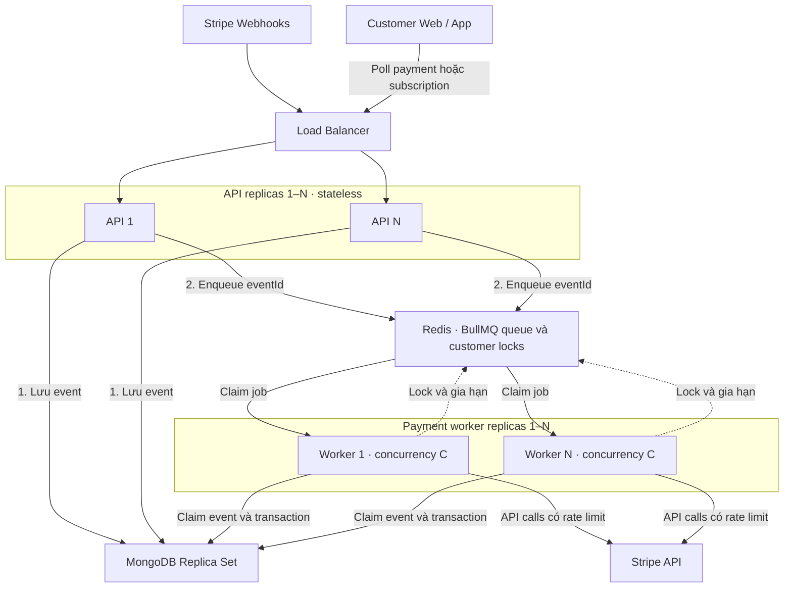
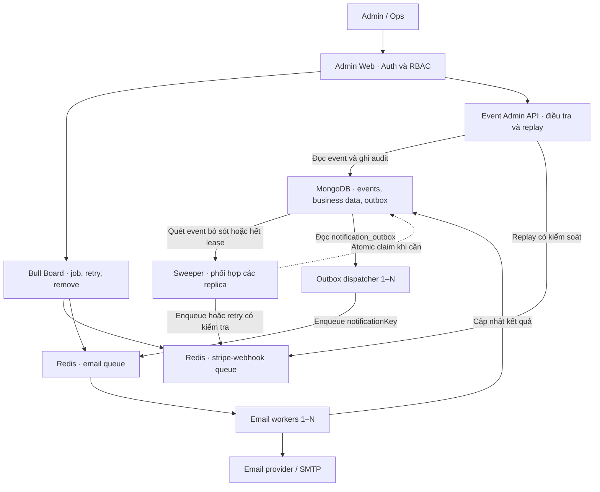
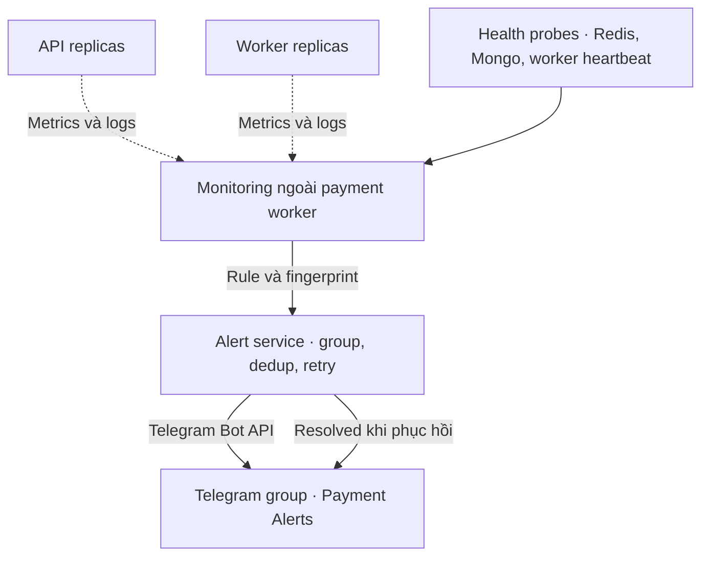

# Stripe Webhook + BullMQ — Thiết kế, vận hành và interview

Ngày: 05/11/2026 · Trạng thái: đề xuất thiết kế, chưa xác nhận đã triển khai.

## 0. System Architecture

### 0.1. Luồng xử lý chính và scale API / worker



API trả 200 cho Stripe sau khi lưu và enqueue thành công. Mũi tên queue → worker biểu diễn worker lấy job, không phải Redis gọi HTTP vào worker. Khi cần đọc hoặc đối soát Stripe, worker gọi Stripe API. MongoDB lưu payload, event state và dữ liệu payment/subscription; Redis giữ job chờ, delayed retry và khóa. Replica set phục vụ độ sẵn sàng và transaction, không tự động chia tải ghi như sharding.

### 0.2. Phục hồi, email và web admin



Dispatcher đọc outbox theo batch và claim atomic để chạy nhiều replica an toàn. Enqueue thành công nhưng chưa kịp đánh dấu outbox có thể tạo lần gửi lặp; notificationKey và email worker cần xử lý tình huống này. Trang Event Admin là phần bổ sung nếu cần xem/replay event Mongo đã mất job Redis; Bull Board chủ yếu quản lý job đang còn trong queue. Thao tác quản trị phải ghi audit qua lớp ứng dụng phù hợp, không mặc định Bull Board đã cung cấp audit nghiệp vụ.

### 0.3. Monitoring và Telegram alert



Monitoring phải quan sát queue age, completion rate, worker heartbeat, Redis/Mongo health và Stripe 429; không chỉ chờ worker tự báo lỗi. Alert service tách khỏi payment worker để payment worker chết vẫn phát hiện được. Tránh đặt đường gửi alert chỉ phụ thuộc vào chính Redis queue đang được giám sát. Telegram lỗi được retry riêng và không làm payment thất bại.

### 0.4. Các component và cách scale

| Component | Trách nhiệm | Cách scale / giới hạn |
|---|---|---|
| Load Balancer | Phân phối webhook và request client | Health check, định tuyến đến API khỏe |
| API 1–N | Verify, lưu event, enqueue, trả trạng thái cho client | Tăng replicas độc lập; không giữ state trong RAM |
| Redis / BullMQ | Waiting, active, delayed retry, job state, customer lock | Tăng RAM/CPU và độ sẵn sàng theo nhu cầu; không giả định thêm worker làm Redis tự scale |
| Payment worker 1–N | Claim, xử lý event, transaction, gọi Stripe | N × C job đồng thời tối đa; chặn theo customer và downstream limits |
| MongoDB replica set | Event store, business data, outbox, audit | Index/query/pool trước; partition/sharding chỉ khi có nhu cầu đã đo |
| Sweeper | Phục hồi received và processing hết lease | Một instance hoặc nhiều instance có phân công/claim; quét theo batch |
| Outbox dispatcher 1–N | Đưa notification bền vững sang email queue | Claim atomic, enqueue idempotent, theo dõi outbox lag |
| Email worker 1–N | Gửi và retry email riêng | Giới hạn theo quota email provider |
| Admin Web + Bull Board | Xem trạng thái, điều tra, retry/replay | RBAC admin/ops; audit; kiểm soát bulk replay |
| Monitoring + Alert service | Phát hiện lỗi, gộp cảnh báo, gửi Telegram | Chạy ngoài payment worker; health check và retry riêng |
| Customer Web / App | Hiển thị pending và poll trạng thái | Backoff/jitter, timeout; không poll dồn dập |

**Ví dụ scale:** bắt đầu N = 2, C = 5 → tối đa 10 job đồng thời. Tăng lên N = 4, C = 5 → tối đa 20 job, nhưng tốc độ thực tế còn phụ thuộc Stripe API, DB, Redis và mức tranh khóa. Không phải mọi event đều gọi Stripe API. Nhiều worker cùng lấy job từ một queue; một job bình thường được một worker claim, nhưng khi worker chết hoặc mất lock, job có thể được xử lý lại.

**Cách kể kiến trúc khi interview:** “Tôi tách hệ thống thành intake API, durable event store, queue và worker pool. API và worker scale độc lập. MongoDB giữ dữ liệu để phục hồi, Redis điều phối job, sweeper khôi phục event bị bỏ sót. Email chạy riêng; admin điều tra và replay; monitoring gửi Telegram khi có sự cố.”

## 1. Giải thích trong 30 giây

API nhận webhook Stripe, xác thực chữ ký, lưu event vào MongoDB rồi đưa eventId vào BullMQ. Worker riêng xử lý nền, chạy song song giữa các customer và dùng khóa khi cùng customer. Event có thể được gửi hoặc chạy lại nhiều lần; unique key, atomic claim và handler idempotent bảo vệ kết quả nghiệp vụ. Lỗi tạm thời có retry; event bỏ sót có sweeper phục hồi; lỗi vận hành gửi Telegram.

## 2. Quyết định triển khai

| Hạng mục | Đề xuất | Mục đích |
|---|---|---|
| Concurrency | Khởi điểm 2 worker × concurrency 5 | Tối đa 10 job đồng thời; kiểm chứng bằng load test |
| Worker | Process/container riêng, dùng chung code với API | Scale và deploy độc lập |
| Khóa | Theo Stripe account + customer; claim riêng theo event | Ngăn xung đột và xử lý trùng |
| Bull Board | Auth hiện có; quyền admin/ops; mặc định chỉ xem | Hạn chế thao tác retry/xóa và có audit |
| Job completed | Tối đa 24 giờ hoặc 10.000 job | Giới hạn Redis |
| Job failed | Tối đa 30 ngày hoặc 50.000 job | Điều tra và retry có kiểm soát |
| Event processed | Đề xuất 90 ngày | Lịch sử vận hành; cân nhắc dung lượng |
| Alert | Telegram, ví dụ group Payment Alerts | Báo sự cố, gộp lỗi và thông báo phục hồi |

Các số trên là điểm bắt đầu, không phải năng lực tải đã được đo. Với age và count, job có thể bị dọn sớm khi vượt count; auto-removal của BullMQ không phải TTL chính xác theo đồng hồ.

## 3. Flow và trách nhiệm

1. **API:** verify chữ ký trên raw body; upsert event bằng unique key. Nếu đã processed thì trả thành công.
2. **API:** enqueue job chỉ chứa eventId. Trả 200 sau khi đã lưu và enqueue; lưu/enqueue lỗi thì trả 5xx theo flow được chọn.
3. **Worker:** đọc event; lấy khóa theo customer và claim event bằng atomic update. Đã processed thì bỏ qua; đang bị xử lý thì chờ/recheck, không coi là thành công.
4. **Worker:** kiểm tra trạng thái nghiệp vụ, xử lý idempotent; cập nhật dữ liệu và event processed trong transaction khi phù hợp. Tạo notification outbox cùng transaction nếu cần email.
5. **Retry:** lỗi tạm thời dùng backoff + jitter. Hết ngân sách retry thì chuyển trạng thái cần can thiệp và báo Telegram.
6. **Sweeper:** quét theo batch các event received bị bỏ sót hoặc processing hết lease. Kiểm tra trạng thái job trước khi enqueue/retry.
7. **Admin:** điều tra, sửa nguyên nhân và replay có quyền hạn, lý do và audit log.

Ví dụ: A có invoice.paid và subscription.updated, B có invoice.paid. Event của A và B có thể chạy song song; hai event của A chờ cùng khóa. Khóa không bảo đảm thứ tự phát sinh trên Stripe.

## 4. Những tình huống interview và kỹ thuật triển khai

| # | Câu hỏi / tình huống | Trả lời khi interview | Kỹ thuật cụ thể |
|---|---|---|---|
| 1 | Tại sao dùng queue? | Trả webhook nhanh, hấp thụ burst và chủ động retry. | API verify → lưu Mongo → enqueue eventId → 200. Worker gọi Stripe và ghi nghiệp vụ ở background. |
| 2 | Stripe gửi cùng event nhiều lần? | Chống trùng tại database và dùng handler idempotent. | Unique (provider, stripeAccountId, eventId); atomic claim. jobId hỗ trợ dedup khi job còn tồn tại trong Redis. |
| 3 | Hai event cùng customer chạy đồng thời? | Customer khác nhau chạy song song; cùng customer chờ khóa. | Lock key theo account/customer, owner token, TTL và gia hạn. Tranh khóa thì đưa job chờ lại, không tiêu ngân sách retry lỗi nghiệp vụ. |
| 4 | Concurrency 1 đã hết race? | Chỉ giới hạn một worker, nhiều worker vẫn chạy đồng thời. | 2 worker × 5 = tối đa 10 job. Dùng khóa phân tán và DB atomic update/transaction. |
| 5 | Event đến sai thứ tự? | Không dùng thứ tự nhận làm căn cứ duy nhất cho trạng thái cuối. | Re-fetch Stripe khi phù hợp; kiểm tra state transition và điều kiện ghi. Không để event cũ đổi PAID về PENDING. Khóa không sắp xếp lại event. |
| 6 | Mongo lỗi lúc nhận? | Chưa lưu bền vững thì chưa xác nhận nhận thành công. | Upsert lỗi → 5xx để Stripe có thể retry. Alert tỷ lệ lỗi webhook và lỗi DB. |
| 7 | Mongo đã lưu nhưng Redis lỗi? | Event còn trong Mongo để phục hồi. | Giữ received; trả 5xx theo flow đã chọn. Sweeper enqueue lại; duplicate được xử lý an toàn. |
| 8 | Worker chết trước khi cập nhật? | Hệ thống chạy lại sau khi phát hiện lần xử lý đã bị bỏ dở. | status, leaseUntil, claimToken; claim atomic và gia hạn lease. Sweeper chỉ reclaim lease hết hạn. |
| 9 | Đã ghi DB nhưng chết trước khi ack job? | Job có thể chạy lại, kết quả nghiệp vụ phải chống trùng. | Unique business key như account + invoiceId. Khi có thể, transaction ghi payment, subscription, event processed và outbox cùng nhau. |
| 10 | Refund thành công nhưng mất response? | Dùng cùng idempotency key và đối soát, không tạo một refund mới ngay. | refund_operations có operationId unique, status, providerRefundId. Lưu ý thời hạn idempotency phía provider; khi kết quả chưa rõ phải reconcile trước khi thử lại. |
| 11 | Stripe chậm hoặc trả 429? | Timeout, backoff và giới hạn tốc độ gọi API. | Áp dụng Retry-After nếu có; giới hạn tổng request trên mọi worker. Job/giây khác request/giây vì một job gọi nhiều API. |
| 12 | Bug hoặc dữ liệu sai, retry vẫn lỗi? | Phân loại lỗi và dừng tự động khi không hữu ích. | attempts, lastError, nextRetryAt; exhausted/dead_letter cần can thiệp. Telegram báo cuối retry; admin replay sau khi sửa nguyên nhân. |
| 13 | Sweeper tạo job trùng? | Sweeper cũng phải an toàn khi chạy lặp. | Query có index, batch/cursor; waiting/active/delayed thì bỏ qua; failed cần retry đúng cách. Phối hợp nhiều sweeper và không reset attempts vô hạn. |
| 14 | SMTP lỗi có chạy lại payment? | Gửi email là tác vụ riêng. | Transaction tạo notification_outbox. Dispatcher enqueue; email worker retry riêng. notificationKey unique hạn chế trùng, nhưng SMTP không tự bảo đảm exactly-once. |
| 15 | Khi nào tăng worker? | Khi tuổi event chờ tăng và downstream còn dư năng lực. | Theo dõi oldest waiting age, ingress/completion rate, P95 duration, 429, DB pool, CPU/RAM; tăng có giới hạn. |
| 16 | Redis mất dữ liệu? | Mongo event store phục hồi các việc chưa hoàn tất. | Redis persistence/replication, noeviction; sweeper enqueue received và processing hết lease. Hết retry cần replay theo chính sách. |
| 17 | Admin tìm lỗi và xử lý? | Có trạng thái, log liên kết và replay được kiểm soát. | Bull Board + trang event nếu cần; eventId/jobId/customerId/traceId trong log; RBAC admin/ops; audit thao tác. |
| 18 | Telegram bị spam? | Gộp theo nguyên nhân, mức ảnh hưởng và thời gian nhắc. | fingerprint, firstSeenAt, lastSentAt, resolvedAt. Alert delivery retry riêng; monitoring ngoài worker phát hiện worker chết. |
| 19 | Xóa job/event ảnh hưởng dedup? | Có; phải tách lịch sử queue khỏi ràng buộc nghiệp vụ. | Redis giữ ngắn hạn; expiresAt chỉ đặt khi processed. Payment/refund vẫn giữ business unique key sau khi event bị xóa. |
| 20 | Thanh toán xong nhưng app chưa active? | Giao diện thể hiện đang xác nhận vì xử lý bất đồng bộ. | Success page poll API payment/subscription có timeout và retry hợp lý; không kích hoạt gói chỉ bằng success_url. |

## 5. Schema tối thiểu

Đây là schema khái niệm, cần điều chỉnh theo mô hình account/tenant và code thực tế.

| Collection | Field chính | Index / lưu ý |
|---|---|---|
| webhook_events | provider, stripeAccountId, eventId, customerId, type, payload, status, attempts, leaseUntil, claimToken, nextRetryAt, lastError, processedAt, expiresAt | Unique (provider, stripeAccountId, eventId); index (status, nextRetryAt), (status, leaseUntil); TTL expiresAt |
| payments | stripeAccountId, stripeInvoiceId, customerId, amount, currency, status | Unique invoice trong account cho luồng invoice; luồng payment khác cần business key phù hợp |
| refund_operations | operationId, paymentId, amount, status, providerRefundId | operationId unique; trạng thái có thể gồm pending, unknown, succeeded, failed |
| notification_outbox | notificationKey, type, payload, status, attempts, nextRetryAt | notificationKey unique; index phục vụ dispatcher |
| admin_audit_logs | actorId, action, eventId, reason, createdAt | Lưu retry/replay/xóa và người thực hiện |

Quy ước stripeAccountId không rỗng, kể cả dùng platform account. Tiền dùng đơn vị nhỏ nhất của currency; không dùng số thực để tính tiền.

Trạng thái event đề xuất: received → processing → processed; lỗi tạm thời chuyển retry_wait; hết retry chuyển dead_letter. Nếu giữ tên failed hiện tại, cần phân biệt rõ đang chờ retry hay đã hết retry.

Lease/lock không thay thế tính đúng ở database. Worker cũ có thể tiếp tục chạy sau khi mất lease; các ghi quan trọng cần điều kiện claimToken/version hoặc cơ chế fencing phù hợp. Chỉ kiểm tra token khi markProcessed chưa đủ bảo vệ mọi business write.

## 6. Retry, retention và alert

### Retry

- Khởi điểm 8 attempts, exponential backoff từ 10 giây và jitter. 8 attempts bao gồm lần đầu; thời gian thực tế phụ thuộc jitter và thời gian xử lý.
- Retry lỗi mạng/timeout/5xx phù hợp; xử lý 429 theo rate limit. Lỗi cấu hình/dữ liệu không thể tự sửa cần can thiệp.
- Worker và sweeper dùng chung ngân sách retry bền vững. Manual replay cần ghi actor/reason và chính sách cấp thêm attempts.
- Tranh khóa hoặc claim đang bận là tình trạng chờ, không phải kết quả processed.

### Retention

```ts
removeOnComplete: { age: 24 * 60 * 60, count: 10_000 },
removeOnFail: { age: 30 * 24 * 60 * 60, count: 50_000 },
```

Mongo: chỉ đặt expiresAt = processedAt + 90 ngày khi processed. Không TTL tự động event lỗi chưa giải quyết. Payment/refund có chính sách lưu riêng. Ví dụ 100.000 event/ngày × 90 ngày = 9 triệu event; payload 5 KB tương đương khoảng 45 GB trước index và replication.

### Telegram

| Điều kiện khởi điểm | Mức / hành vi |
|---|---|
| Event thanh toán hết retry | Báo ngay, gộp nguyên nhân |
| Event chờ lâu nhất > 2 phút | Warning |
| Event chờ lâu nhất > 10 phút | Critical |
| Có backlog nhưng không hoàn tất job trong 5 phút | Critical |
| Redis/Mongo lỗi hoặc không còn worker khỏe | Critical |
| Tăng tỷ lệ Stripe 429 | Warning; đánh giá giảm tốc độ |
| Hết điều kiện lỗi | Resolved |

Alert gồm environment, eventId mẫu, loại event, lỗi đã làm sạch, attempts, số event bị ảnh hưởng và link Bull Board. Không gửi payload hoặc thông tin nhạy cảm. TELEGRAM_BOT_TOKEN và TELEGRAM_CHAT_ID nằm trong secret manager/env. Telegram lỗi không làm payment thất bại. Chỉ cấu hình kênh và gửi tin khi triển khai; tài liệu này không tạo group hay gửi tin.

## 7. Checklist triển khai và kiểm chứng

- [ ] API xử lý raw body/signature đúng; chỉ lưu event hợp lệ; enqueue lỗi trả đúng response.
- [ ] Worker riêng; graceful shutdown; giới hạn concurrency, timeout và downstream requests.
- [ ] Unique index, atomic claim, khóa customer, lease renewal và điều kiện ghi khi mất lease.
- [ ] Transaction cho dữ liệu liên quan; idempotency key và reconciliation cho API ngoài.
- [ ] Sweeper theo batch, có index, phân biệt job waiting/active/delayed/failed; không retry vô hạn.
- [ ] Bull Board bảo vệ cả router/API quản trị; quyền retry/xóa, audit và dữ liệu hiển thị phù hợp.
- [ ] Outbox/email retry riêng; Telegram grouping, recovery và giám sát worker từ bên ngoài.
- [ ] Kiểm thử duplicate event, hai event cùng customer, event sai thứ tự và nhiều customer đồng thời.
- [ ] Kill worker trước/sau DB commit; giả lập Redis/Mongo lỗi; Stripe timeout/429; refund response bị mất.
- [ ] Load test burst; đo throughput, queue age, processing P95, DB pool và 429 trước khi tăng worker.

## 8. Sample answer — khoảng 1 phút

> I designed Stripe webhook processing around a durable event store and a background queue. The API verifies the signature, stores the event in MongoDB, and enqueues its ID before returning a successful response.
>
> Separate BullMQ workers process events concurrently across customers. For the same customer, a distributed lock prevents conflicting updates. Since events can be delivered more than once, the handlers are idempotent and use atomic database checks.
>
> Temporary failures are retried with exponential backoff. A recovery process finds events that were missed or abandoned after a worker crash. We use Bull Board for investigation and Telegram for operational alerts.
>
> To scale, I monitor queue waiting time, processing throughput, database load, and Stripe rate limits, then adjust worker capacity accordingly.

Dùng “I would design” nếu trình bày phương án chưa triển khai; chỉ dùng “I designed” khi đúng với kinh nghiệm thực tế.

Cách trả lời câu hỏi sâu: **vấn đề → cơ chế → dữ liệu bảo vệ → cách phục hồi**.

Ví dụ: “Nếu worker chết sau khi ghi nhận thanh toán, job có thể chạy lại. Tôi dùng unique invoice ID và transaction để tránh tạo payment trùng. Nếu thao tác gọi ra ngoài như refund, tôi dùng idempotency key và đối soát vì DB transaction không bao trùm được Stripe API.”

## 9. Tài liệu tham khảo

- [Stripe webhooks: duplicate events, ordering, asynchronous processing](https://docs.stripe.com/webhooks)
- [BullMQ worker concurrency](https://docs.bullmq.io/guide/workers/concurrency)
- [BullMQ auto-removal of jobs](https://docs.bullmq.io/guide/queues/auto-removal-of-jobs)
- [BullMQ rate limiting](https://docs.bullmq.io/guide/rate-limiting)

Tổng hợp từ thảo luận thiết kế; các ngưỡng và schema là đề xuất, cần đối chiếu phiên bản thư viện và hệ thống thực tế khi triển khai.
