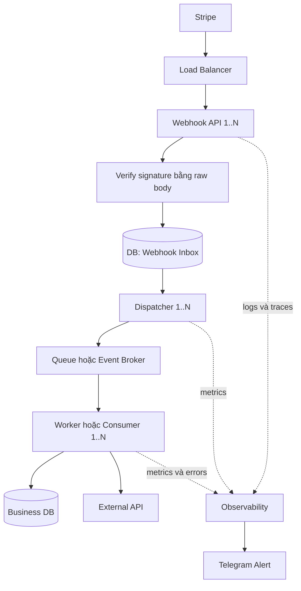
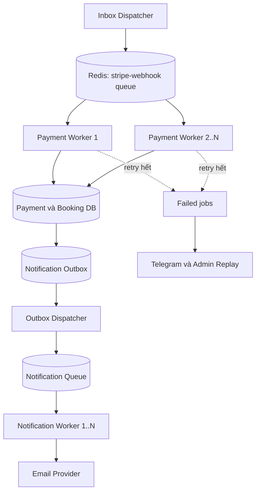
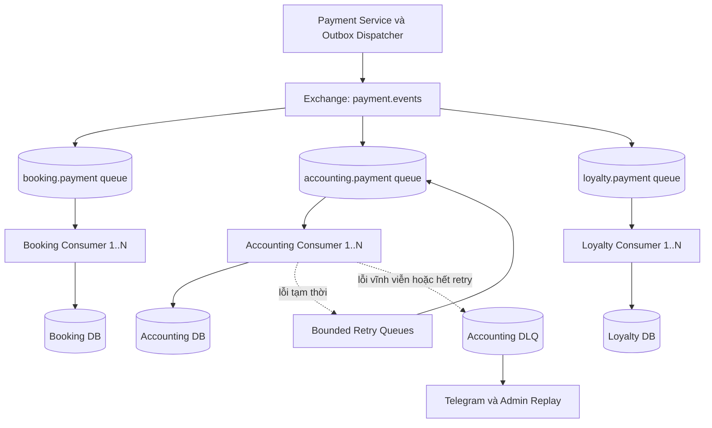
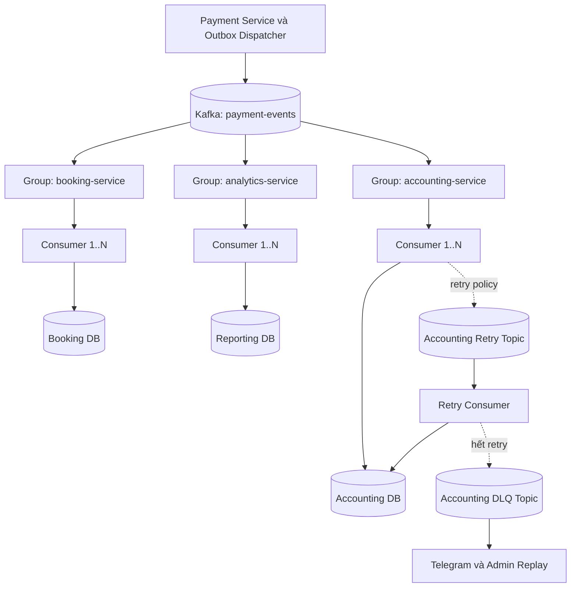

# Stripe Webhook: BullMQ, RabbitMQ hay Kafka?

Tài liệu system design và chuẩn bị phỏng vấn • 05/11/2026

Các kiến trúc dưới đây là phương án đề xuất để minh họa ClubSync/Kygo, không phải xác nhận cấu hình đang chạy của các dự án.

## 1. System Architecture — nhìn tổng thể trước

Tách hai việc: tiếp nhận webhook đáng tin cậy và xử lý nghiệp vụ bất đồng bộ. Đổi broker không tự giải quyết tính đúng đắn của thanh toán.



**Luồng đề xuất:** verify chữ ký → lưu inbox bền vững → trả `2xx` → dispatcher đưa vào broker → worker cập nhật nghiệp vụ. Inbox có unique key theo nguồn + Stripe account + event ID. Dispatcher quét bản ghi chưa giao để phục hồi khi broker lỗi; không chỉ phụ thuộc vào tín hiệu trong memory.

Nếu chọn thiết kế đơn giản không có inbox: verify → enqueue thành công → trả `2xx`; enqueue thất bại thì trả lỗi để Stripe retry. Độ bền lúc này phụ thuộc cấu hình broker. Không trả `2xx` trước khi đã tiếp nhận bền vững. [1]

**Khi inbox đã commit mà broker đang lỗi:** vẫn có thể trả `2xx` vì dispatcher chịu trách nhiệm giao lại. Đây là điểm khác với phương án enqueue trực tiếp.

## 2. Chọn nhanh

| Công cụ | Cách hiểu | Trường hợp điển hình |
|---|---|---|
| BullMQ trên Redis | Giao việc cho worker | Xử lý webhook, gửi email, nhắc lịch, báo cáo |
| RabbitMQ với AMQP queues | Phân phối message bằng exchange và binding | Nhiều service nhận event, routing theo loại nghiệp vụ |
| Kafka | Nhật ký sự kiện có retention và offset | Replay, analytics, nhiều pipeline dữ liệu độc lập |

Đây không phải ba cấp độ bắt buộc phải nâng cấp lần lượt. Nhiều service, nhiều ngôn ngữ hay traffic tăng đều chưa đủ để kết luận phải đổi công cụ. Cần xét nhu cầu, SLA, năng lực vận hành và benchmark.

## 3. BullMQ — background jobs trong backend



**Ví dụ:** Stripe báo thanh toán thành công. Một worker nhận job, ghi payment và xác nhận booking trong transaction phù hợp. Notification outbox được ghi cùng transaction để tránh payment đã commit nhưng job gửi email bị mất. Dispatcher tạo job thông báo sau đó.

Các worker trong cùng queue chia nhau xử lý; không phải mỗi worker đều nhận một bản của mỗi job. Job vẫn có thể được thực hiện lại khi có lỗi nên nghiệp vụ phải idempotent.

BullMQ hỗ trợ attempts và backoff. Failed jobs cần chính sách lưu, cảnh báo và replay. Với Redis, cấu hình persistence và `maxmemory-policy=noeviction`; cân nhắc tách Redis queue khỏi Redis cache. Persistence/replication không thay thế backup và đối soát. [2][3]

| Thay đổi | Có cần chuyển khỏi BullMQ? |
|---|---|
| Tăng từ 1 lên 5 worker | Không; kiểm tra concurrency, DB connections và Stripe rate limit |
| Thêm gửi email, nhắc lịch | Không; tách queue nếu cần scale hoặc retry riêng |
| Nhiều backend cùng tạo job | Không bắt buộc; thống nhất job schema và ownership |
| Nhiều service cần tự đăng ký nhận domain event | Bắt đầu đánh giá broker có routing/pub-sub phù hợp |

## 4. RabbitMQ — routing tới nhiều service độc lập



Payment Service xử lý webhook và ghi payment + domain outbox trong transaction. Dispatcher publish `payment.succeeded`; exchange routing tới queue của từng service. Mỗi service có DB, backlog và retry riêng. Sơ đồ chỉ vẽ nhánh retry của Accounting; các service còn lại cần chính sách tương tự.

| Event routing key | Queue đăng ký ví dụ | Nghiệp vụ |
|---|---|---|
| `payment.succeeded` | Booking, Accounting, Loyalty | Xác nhận booking, ghi doanh thu, cộng điểm |
| `payment.refunded` | Accounting, Loyalty | Ghi hoàn tiền, điều chỉnh điểm |
| `payment.failed` | Notification | Báo thanh toán thất bại |

Exchange và binding quyết định message tới queue nào. Thêm Analytics có thể khai báo queue và binding mới mà không sửa publisher, nếu event contract đã đủ dữ liệu. Queue mới thường chỉ nhận message phát sinh sau khi binding được tạo; không tự nhận lịch sử trước đó. [4]

**Ví dụ đáng cân nhắc RabbitMQ:** ClubSync tách Accounting thành service riêng do team khác quản lý. Accounting có thể dừng 2 giờ, trong khi Booking vẫn xác nhận sân. Team Accounting tự quản lý queue, retry và DLQ. BullMQ vẫn xây được mô hình tương tự; RabbitMQ giúp chuẩn hóa routing và cơ chế messaging.

Để vận hành tin cậy: dùng queue bền vững phù hợp, persistent messages, publisher confirms; consumer ack sau khi commit DB. Confirm chỉ xác nhận phía broker, không có nghĩa consumer đã xử lý. Cần xử lý unroutable message, chẳng hạn `mandatory` và returned messages; publish được confirm nhưng không có queue phù hợp vẫn có thể không tới nơi mong muốn. [5]

## 5. Kafka — lưu event để đọc độc lập và replay



Mỗi consumer group theo dõi tiến độ riêng trên từng partition. Trong một group, các consumer chia partition; group khác vẫn có thể đọc cùng event. Số consumer chủ động đọc trong một group bị giới hạn bởi số partition được gán.

Kafka giữ event theo retention ngay cả sau khi consumer đọc. Replay chỉ khả thi với dữ liệu còn tồn tại; nếu dùng compaction, không được giả định vẫn giữ đầy đủ mọi phiên bản sự kiện. Thứ tự được đảm bảo trong một partition. Chọn key như `bookingId` để gom event cùng booking; điều này không sửa được việc Stripe gửi event sai thứ tự ngay từ đầu. [6]

| Tình huống | Cách áp dụng Kafka | Điều cần kiểm soát |
|---|---|---|
| Tháng sau thêm Analytics | Group mới đọc lịch sử còn trong retention | Retention phải đủ dài; không có dữ liệu đã bị xóa |
| Cần dựng lại doanh thu | Replay vào bảng tổng hợp mới rồi đối chiếu | Event phải đủ dữ liệu và có version schema |
| Loyalty tính sai 7 ngày | Replay để tính kết quả đúng và tạo điều chỉnh | Dedupe bình thường có thể bỏ qua event cũ; dùng projection/version mới hoặc cơ chế correction |
| Klarda có luồng dữ liệu giá | Chart, alert và analytics dùng group riêng | Partition key, lag, hot partition và dung lượng |

**Replay báo cáo khác với chạy lại thanh toán.** Không replay mù các consumer gọi hoàn tiền hoặc gửi email. Kafka transactions không tự bảo đảm exactly-once cho DB bên ngoài hay Stripe API.

Kafka retry cần chủ động thiết kế: chặn partition để giữ thứ tự, hoặc đưa sang retry topic để tiếp tục xử lý. Retry topic có thể làm thay đổi thứ tự hoàn tất; cần xử lý trạng thái nghiệp vụ. Không commit vượt qua event chưa xử lý nếu chưa chuyển giao event đó an toàn sang cơ chế phục hồi.

## 6. So sánh trade-off

| Tiêu chí | BullMQ trên Redis | RabbitMQ AMQP queues | Kafka |
|---|---|---|---|
| Mô hình chính | Job queue | Message routing | Partitioned event log |
| Nhiều bên nhận cùng event | Thiết kế queue/job riêng | Exchange → queue mỗi service | Consumer group mỗi service |
| Scale xử lý | Thêm worker, chỉnh concurrency | Thêm consumer, chỉnh prefetch | Thêm consumer tới giới hạn partition |
| Retry | Attempts/backoff có sẵn | Retry queue/DLX hoặc cơ chế ứng dụng | Retry topic hoặc giữ partition |
| Replay lịch sử đã xử lý | Cần lưu nguồn lịch sử riêng | Queue thường không phục vụ replay sau ack | Có trong giới hạn retention |
| Thứ tự hoàn tất | Không mặc định khi chạy song song/retry | Không mặc định với nhiều consumer/redelivery | Theo partition ở luồng đọc; retry/song song cần kiểm soát |
| Vận hành | Thuận tiện nếu đã quản lý Redis đúng chuẩn | Thêm topology, confirms, queue health | Thêm partition, retention, lag, replication |

Phạm vi bảng: job queue BullMQ dùng Redis và RabbitMQ queues thông thường. RabbitMQ Streams cũng hỗ trợ lưu và replay; không nên nói “RabbitMQ hoàn toàn không replay được”. Đây là so sánh mô hình sử dụng, không phải liệt kê toàn bộ tính năng của từng sản phẩm.

## 7. Failure handling chung

| Sự cố | Cách xử lý | Vì sao cần |
|---|---|---|
| Signature không hợp lệ | Từ chối, không xử lý | Xác thực nguồn webhook |
| Event trùng | Unique inbox key + consumer idempotency | Broker và Stripe đều có thể giao lại |
| Inbox DB không ghi được | Trả lỗi, không trả `2xx` | Chưa nhận trách nhiệm bền vững |
| Broker lỗi sau khi inbox commit | Dispatcher retry; theo dõi tuổi bản ghi chưa giao | Không mất event đã nhận |
| Publish thành công nhưng dispatcher chưa đánh dấu | Có thể publish lại; consumer dedupe | Không thể coi DB và broker là một transaction mặc định |
| Worker commit rồi chết trước ack/commit offset | Event chạy lại; transaction kèm dedupe | Ngăn cộng điểm, doanh thu hoặc refund trùng |
| Stripe API timeout | Dùng idempotency key ổn định cho thao tác hỗ trợ; tra cứu/đối soát trạng thái | Timeout không chứng minh thao tác chưa thực hiện |
| Event sai thứ tự | State machine, điều kiện cập nhật; lấy trạng thái Stripe khi cần | Không chuyển trạng thái lùi theo event cũ |
| Poison message | Retry có giới hạn → failed/DLQ + Telegram | Tránh lặp vô hạn hoặc chặn luồng mãi |
| Backlog tăng | Kiểm tra DB, external API, consumer; scale có giới hạn | Thêm worker có thể làm DB quá tải |
| Broker mất dữ liệu | Khôi phục, replay từ nguồn lưu và đối soát Stripe | Cần kế hoạch recovery ngoài retry |
| Thanh toán tới sau khi booking hết hạn | Chính sách nghiệp vụ: refund hoặc kiểm tra lại availability | Không tự xác nhận sân/váy đã được người khác đặt |

**Dedupe phải có tính nguyên tử:** ghi dấu đã xử lý và thay đổi nghiệp vụ trong cùng transaction khi khả thi. Không ghi `processed=true` trước rồi mới cập nhật payment. Với external side effects, dùng outbox và idempotency của bên nhận; không giả định transaction DB bao phủ network call.

## 8. Schema tối thiểu đề xuất

| Thành phần | Trường chính | Ràng buộc |
|---|---|---|
| `webhook_inbox` | source, stripeAccountId, eventId, type, payload, status, attempts, nextAttemptAt, receivedAt | Unique theo nguồn/account/event; trạng thái dispatcher không đồng nghĩa nghiệp vụ hoàn tất |
| `processed_events` | consumerName, eventId, processedAt | Unique theo consumer + eventId; ghi cùng transaction nghiệp vụ |
| `payments` | paymentId, stripePaymentIntentId, bookingId, amount, currency, status | Unique payment intent theo account; lưu tiền bằng đơn vị nhỏ nhất |
| `domain_outbox` | eventId, aggregateId, type, schemaVersion, payload, publishedAt | Ghi cùng transaction cập nhật nghiệp vụ |
| `processing_failures` | eventId, consumer, errorCode, attempts, nextAction | Có trạng thái xử lý, quyền replay và audit |

Inbox lưu event Stripe gốc; domain outbox lưu event nghiệp vụ sau khi hệ thống đã kiểm tra và cập nhật trạng thái. Hai event có mục đích khác nhau. Payload cần giới hạn quyền truy cập và thời gian lưu dữ liệu nhạy cảm.

## 9. Monitoring từ browser và Telegram

| Màn hình/chỉ số | Giúp trả lời |
|---|---|
| Inbox pending count + oldest age | Đã nhận webhook nhưng chưa giao broker bao lâu? |
| Queue waiting/active/failed; oldest job age | Worker có xử lý kịp không? |
| RabbitMQ ready/unacked, return/nack | Message đang chờ, đang xử lý hay routing lỗi? |
| Kafka lag và thời gian từ event tới xử lý theo group | Service nào chậm? Còn đủ retention để phục hồi không? |
| Business processing status | Booking đã xác nhận, Accounting đã ghi nhận chưa? |
| Trace/log theo eventId, paymentId, bookingId | Lỗi tại bước nào? |
| Stripe reconciliation | Có payment thành công nhưng DB chưa ghi đúng không? |

Queue ack hoặc Kafka offset không phải dashboard nghiệp vụ đầy đủ. Muốn biết từng service đang xử lý/thành công/thất bại phải có log, trace và trạng thái nghiệp vụ tương ứng.

Ví dụ Telegram:

```text
[FIRING] PaymentProcessingDelayed
Service: accounting
Oldest pending event: 12 minutes
Event: evt_example
Payment: pay_example
Trace: <trace URL>
Dashboard: <dashboard URL>
Action: inspect DB errors and failed messages before replay
```

Ngưỡng phải lấy từ SLA. Ví dụ cảnh báo độ trễ 2 phút là lựa chọn vận hành, không phải mặc định của công cụ.

## 10. Khi nào nên chuyển hoặc kết hợp?

| Dấu hiệu | Quyết định đề xuất | Ví dụ |
|---|---|---|
| Chủ yếu background jobs, NestJS và Redis đã có | Giữ BullMQ | Webhook + email + nhắc lịch ClubSync |
| Nhiều team/service cần tự đăng ký event, routing và backlog riêng | Đánh giá RabbitMQ | Booking, Accounting, Loyalty phát triển độc lập |
| Cần lịch sử event để thêm consumer mới, rebuild và analytics | Đánh giá Kafka | Reporting mới cần đọc lại payment 30 ngày |
| Chỉ traffic tăng | Benchmark và tìm bottleneck trước | DB chậm thì thay broker không giải quyết |
| Đã có nền tảng broker được vận hành tốt | Ưu tiên tái sử dụng nếu đáp ứng yêu cầu | Không thêm Redis chỉ để dùng BullMQ nếu RabbitMQ đã đủ |
| Vừa cần event bus vừa cần delayed jobs | Kết hợp có chủ đích | RabbitMQ/Kafka cho domain events, BullMQ cho nhắc lịch |

Khi chuyển: chuẩn hóa event ID/schema → triển khai consumer idempotent → publish qua outbox → chạy consumer mới ở chế độ đối chiếu, không tạo tác dụng phụ → kiểm tra số lượng và kết quả → chuyển từng consumer → drain queue cũ. Không chạy hai consumer thực hiện refund/song song mà chưa có cơ chế chống trùng xuyên hai luồng.

## 11. Câu trả lời phỏng vấn

**Why BullMQ for Stripe webhooks?**

“We chose BullMQ because the workload was background job processing in our NestJS application, and we already operated Redis. We used retries and backoff, with idempotent database updates to handle duplicate delivery. We acknowledged webhooks only after durable acceptance.”

**When would you consider RabbitMQ?**

“When multiple independent services need event routing and their own queues, RabbitMQ can make that topology easier to manage. For example, Booking, Accounting, and Loyalty can each consume payment events and recover independently.”

**When would you consider Kafka?**

“When we need retained event history, independent consumer groups, and replay for analytics or rebuilding projections. Kafka would not remove the need for idempotency, especially for external payment operations.”

Các câu trả lời trên là mẫu; chỉ dùng “we used” cho những phần bạn đã thực sự triển khai.

## 12. Tài liệu tham khảo chính thức

1. [Stripe — Webhooks](https://docs.stripe.com/webhooks)
2. [BullMQ — Retrying failing jobs](https://docs.bullmq.io/guide/retrying-failing-jobs)
3. [BullMQ — Going to production](https://docs.bullmq.io/guide/going-to-production)
4. [RabbitMQ — Exchanges](https://www.rabbitmq.com/docs/exchanges)
5. [RabbitMQ — Consumer acknowledgements and publisher confirms](https://www.rabbitmq.com/docs/confirms)
6. [Apache Kafka — Design](https://kafka.apache.org/41/design/design/)

Các lựa chọn kiến trúc và schema trong tài liệu là đề xuất thiết kế cho ví dụ, không phải cấu hình bắt buộc từ nhà cung cấp.
